# OpenTour v. 2.0 Manual

For installation instructions for v. 2.0, see the [README.md](https://github.com/ecds/OpenTourBuilder/blob/master/README.md). This is an overview using OpenTour v. 2.0 for your projects. It assumes you already have OpenTour v. 2.0 set up on your system and have a url ready.

### 1. Access your main administration page using the *login page*. This manual uses Emory University’s Campus Tour as an example. The login page looks like this:

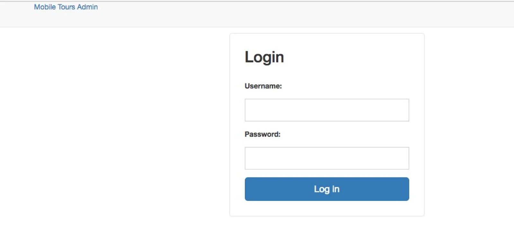

### 2. After login, you’ll see an *overview screen*.  Ignore "*Auth*" and "*Sites*". Most of your work will occur through “*Tours*” under the “*Tour*” header.

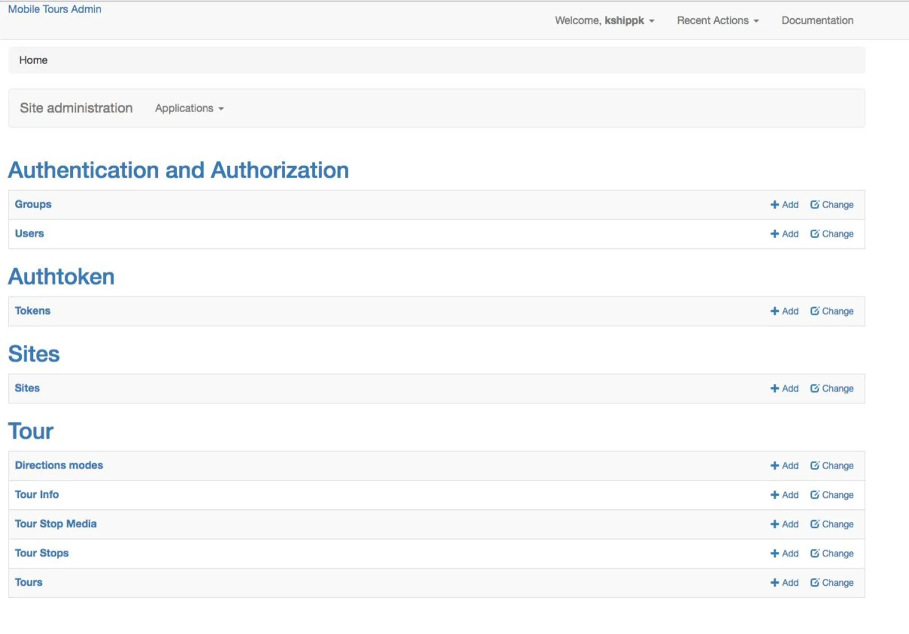

#### The first four options under Tours include:
- **Directions Modes**:  where you can add and delete custom types of transportation that Google Maps will utilize in your tour
- **Tour Info**:  which lets you create, edit, and delete tour information.
- **Tour Stop Media**:  where you create, edit, and delete tour stop media (only images at this point)
- **Tour Stop**:  where you can create, edit, and delete tour stops.

> *It’s important to note that when you click Tour Stop Media for example, it lists all of the media available for all tours, which you then allocate, and the same for the other categories.*

To make a new tour, click "**Tour**" , and choose "**Tours**". Which gives us the ability to create, edit, and delete tours.

### 3. This "*Tours*" page allows you to add a new tour or select an existing tour in order to make edits. Let's make a new tour by selecting "*Add Tour.*"

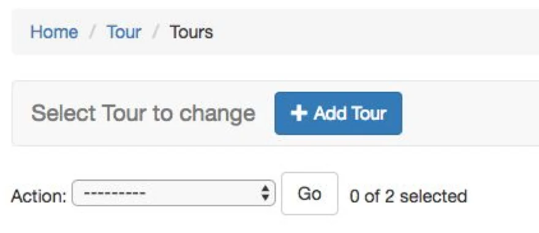

> “**Add Tour**” takes us to a page with a form to create and customize the main tour page (what you see when you go to your published site) and a number of basic details about the tour. The 'tour' page also includes places for adding "tour info" and "tour stops". Most of these are pretty self- explanatory, but to overview:

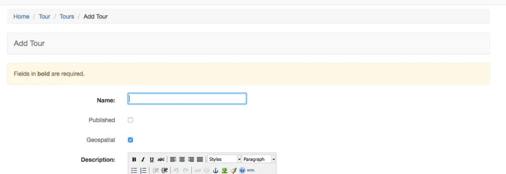

#### The fields for this screen include the following:
- **Name**:  Tour name
- **Published**:  Check this box to have your tour published and viewable at your address (e.g. http://tour.emory.edu/).
- **Description**:  This should be the Tour description that appears on the main tour page.
- **Modes**:  This will be the mode of transportation for tour. More than one can be chosen. Custom modes can be created by clicking the green plus icon where a new window pops up for entering the name of a custom mode and then save it.
- **Default mode**:  Choose the default mode that your tour will use to determine directions (based on Google Maps) 
- **Google Analytics**:  You can integrate your tour with Google Analytics here.
- **Splashimage**: This image appears on the main tour page.

Once you have completed these steps,  click “**Save**”  at the bottom of the window.

### 4. We will deal with “*Tour Info*” now.  “*Tour Info*” and “*Tour Stops*” can both be added in two places. First, on the Tour page that you just created, you can click "*+ Add Another Tour Info*.” 

> With “*Tour Info*”s we can add multiple pages of information for the tour (that are not part of stops). These will appear as a menu on the main page. These can include an About page, or any other information you want to share overall.

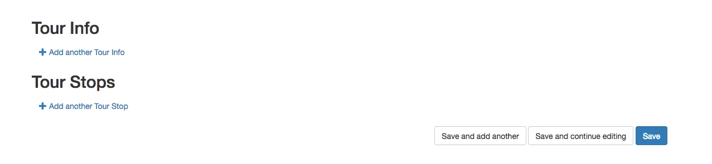

##### This will bring up the following form.

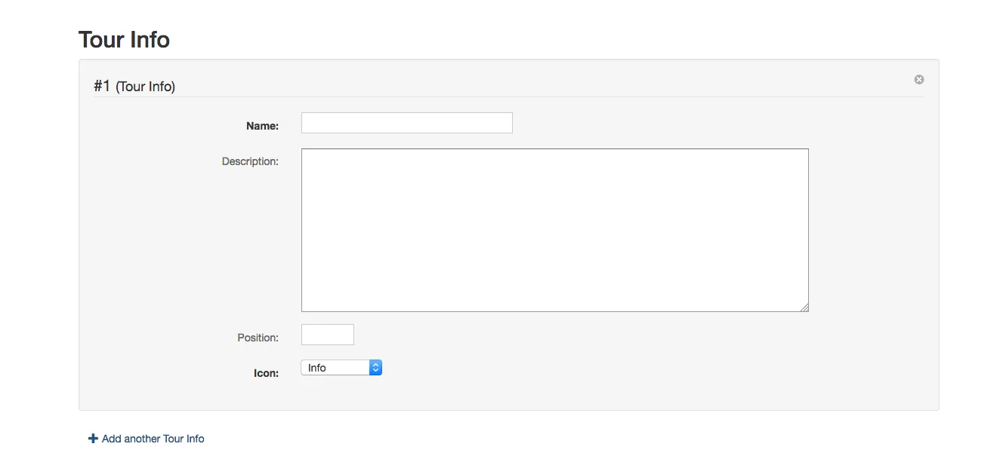

### Or, you can return to the “*Home*” page by the link on the top left and select the “*Tour Info*” page.

##### The “*Home*” link is on the left (see below).

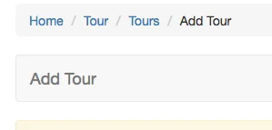

##### Once on the “*Home*” page, choose the “*Tour Info*” page.

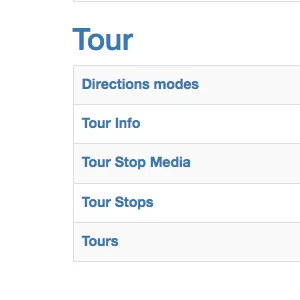

### For this option, once you select the “*Tour Info*” page, then select the *+ Add Tour Info* button.

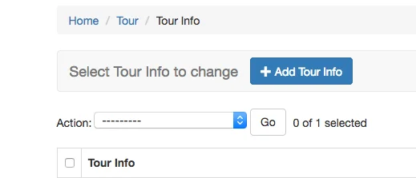

> As we said, with “*Tour Info*”s we can add multiple pages of information for the tour (that are not part of stops). These will appear as a menu on the main page. These can include an About page, or any other information you want to share overall.

##### The Home, "info", and star icons below are the “*Tour Info*”s menu on the Emory Tour site.

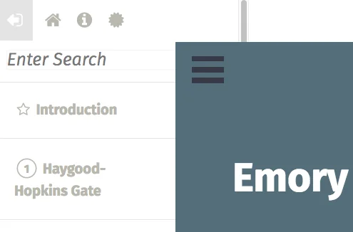

##### Add Tour Info will bring up this form.

The fields on "Add Tour Info" include:
- **Name**: The name of the page.
- **Description**: The text you want included.
- **Position**: The number of the order in which you want the page to appear in the menu (1, 2, etc.).
- **Icon**: You can choose from a list of icons, such as the *house* icon or the *circle* icon.

> *Notice that the position option orders the tour info entries. You can number them to order them. You can also reorder them from within your original Tour page in the Tour/Tours menu, if you want to change their order later.*

### 5.  Now let us consider “*Tour Stops*”. Further down on your Tour page, under “*Tour Stops*”, click on "*+ Add Another Tour Stop*" in order to add multiple tour stops. 

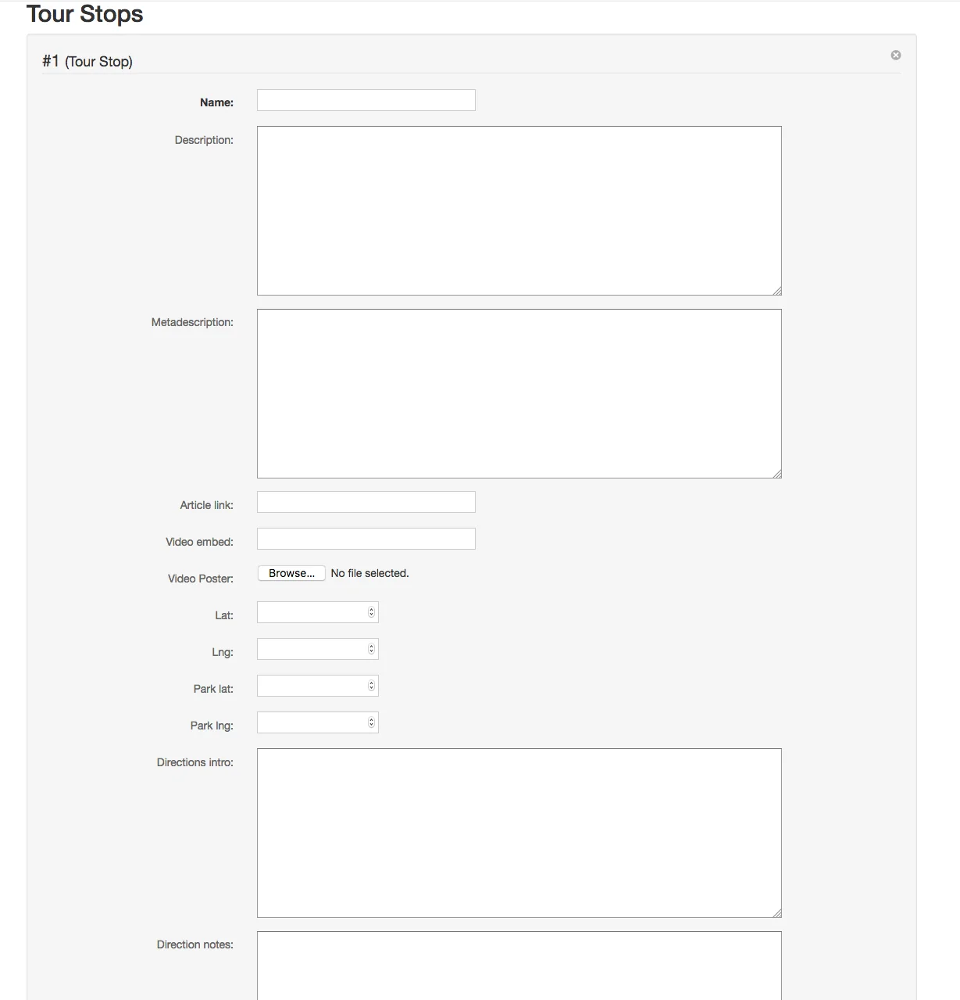

#### You can also add "*Tour Stops*" from its own menu from the main page, as we showed with "*Tour Info*". As with "*Tour Info*", go to "*Home*", then "*Tour Stop*". 

##### This will allow you to choose the *+ Add Tour Stop* button, which opens the same Tour Stop form.

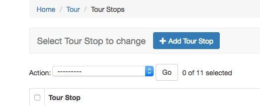

> If you add a Tour Info or a Tour Stop from its own menu, instead of the Tour page, you will have to select your Tour from the drop down menu. 
> It’s **important** to notice that the first tour stop entry (the one we give position 0) will, by default, be treated as the introduction to the tour and starting point, and will not appear under the *Tour Stop* header on the tour page! This allows us to see all of the stops as an overview. So, you **need** to enter an "Introduction" or "Welcome" stop in the first position in addition to all your other tour stops!

Here you can also fill in a lot of information about the tour, such as:
- **Name**:  This is the name of specific tour stop.
- **Description**:  Enter the description of the tour stop, as well as images, videos, and other formatting styles. 
- **Metadescription**:  Enter the text, which can be a repetition of text from the Description field, that you would want to show up if the stop was linked in a Tweet, and which will show up along with the name of the stop on the general tour map (in the pop-up).
- **Article link**:  Link to outside article that provides more information on tour stop. Will appear on site as a link that reads "**Learn more**."
- **Video embed**:  This lets you insert a video embed code for a YouTube video. This is a better option than uploading the video directly to the site which can make your tour load slowly.
- **Lat/Lng**: Insert latitude and longitude coordinates to allow the tour stop to appear on the Google Maps insert.
- **Park lat/Park lng**: Enter the latitude and longitude coordinates for the tour stop parking location.
- **Directions intro**: Enter directions information.
- **Directions notes**: Enter any notes pertaining to specific directions.
- **Position**: The number of the order in which you want the stop to appear in your tour. Give the first entry '0' and it will show up as your introduction.  Then number from '1'.

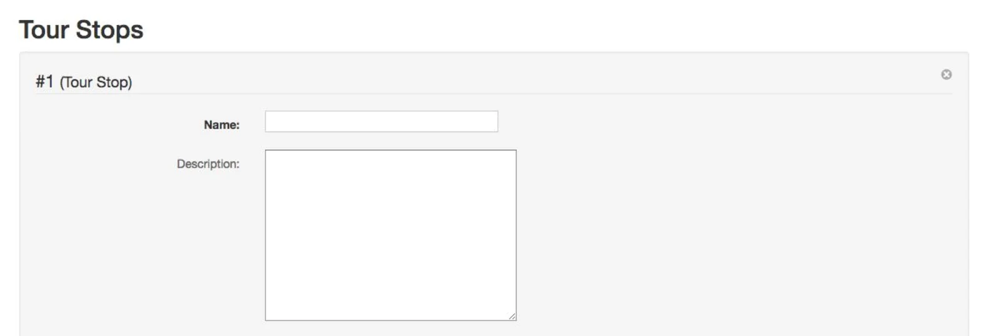

### 6.  Now we technically have all that we need to complete a tour. However, OpenTour organizes the information we’re populating here to make it easier.

Back on the “**Tour**” main menu, we see several options.  
You shouldn’t need to use the **Directions** options as they’re already created for you.   
We have gone over the “**Tour Stops**”, which will now include an overview of all of the stops we have created (for all tours together) in one place. As we covered, you can add new stops here as well as from the individual tour page we were using earlier. We also looked at the "**Tour Info**" option, which functions the same way, listing all Tour Info pages.

These pages are particularly helpful if you’re creating several different tours and want to switch a stop or info page from one tour to another. If you click on a “**stop**” for example, you can use the *drop down menu* to decide to which tour to allocate it. Clicking “**Tour Info**” works exactly the same way.

### 7.  The last thing we need to review is how to add images to the tour stops. If we go back to the “*Home*” page, and  click “*Tour Stop Media*” under “*Tour*” it takes us to a page where we can add images to go with different stops. It works like the “*Tour Stops*” page.

To add a new image, click the “**+ Add Tour Stop Media**” button. Then, in the form that appears, choose the stop where you want the image to display from the drop-down menu. 

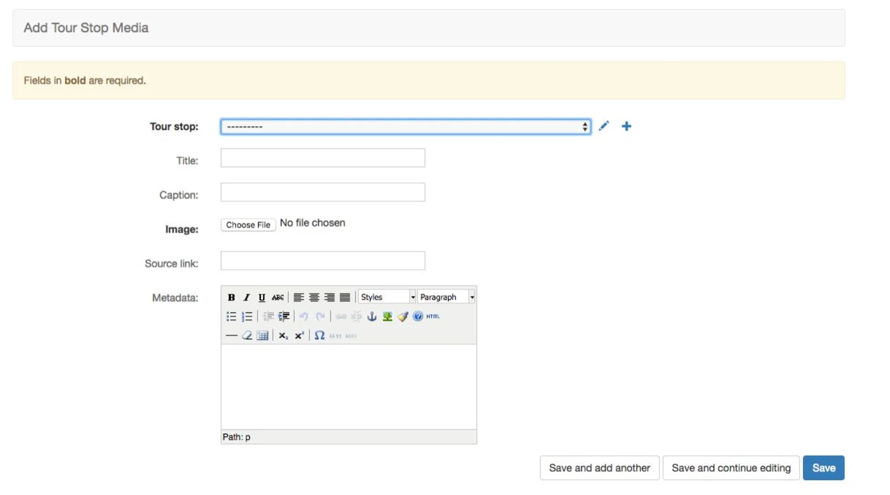

Fill in the information about the picture, such as the Title and caption.  **Upload** your picture with the "**Choose File**" button, and  click “**Save**.” The Metadata field is a good place for licensing information that you want to show in search engines. 
If you have an image you want to put on a different stop go back to “**Tour Stop Media**”, click the image and use the *drop down menu* to decide to which tour to allocate it, and click “**Save**.”

### 8. Here's what the published tour looks like: You see the “splash image” here at tour.emory.edu.

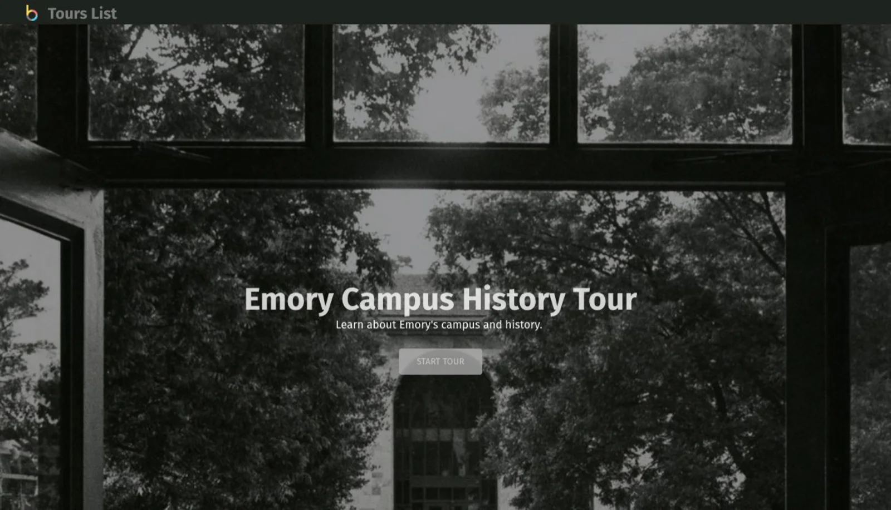

Click **START TOUR** to see the tour you have set up. On the left is a sidebar with all of our stops.

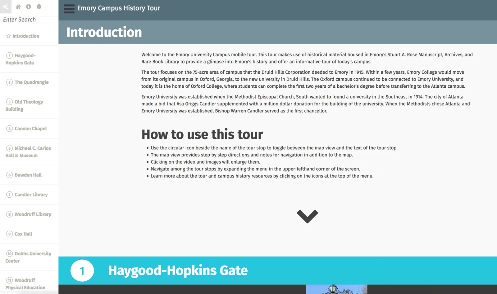

At the top left is the menu.
- Clicking the “*house*” icon refreshes the home page
- Clicking the “*i*” icon brings up the first “*Tour Info*” item, which we called About.
- Clicking the “*circle*” icon brings up the second “*Tour Info*” item, which we called Resources to Learn More.

The top of the page is the tour introduction, which is populated with the information you put in the first “*Tour Stop*” when you first created your tour. The first “*Tour Stop*” is programmed to be an overview stop, so clicking on the *maps* icon brings up the map overview.

### 9. Scrolling down to the first stop on the tour and clicking the map icon should bring up all of my information about that stop. You can click the “*i*” icon again to toggle back, and continue exploring your tour.
