# OpenTour v. 3.0 Manual (including 3.1 updates for admin / 4.0 updates for public view)
Updated October 5, 2026.

For installation instructions for v. 3.0+, see the [README.md](https://github.com/ecds/OpenTourBuilder/blob/develop/README.md). This is an overview using OpenTour v. 3.0+ for your projects. It assumes you already have OpenTour v. 3.0+ set up on your system or have access to an installation and have a url ready.

If you want to use OpenTour, you can find out more [on the about page](index.md) and apply for a site [on the Emory webpage](https://digitalscholarship.emory.edu/opentour-builder-proposal-process/) or read about teaching with the OpenTour app [on the ECDS blog](https://scholarblogs.emory.edu/ecds/ecds-resources-feature-opentour/) and find out how to apply for help in getting your own site.

****NOTE*** - The URLs for Emory University's official installation of OpenTour Builder have changed:
- FROM: https://opentour.emory.edu/ with https://opentour.emory.edu/tour-site-name for each Tour Site
- TO: https://opentour.site with a subdomain https://tour-site-name.opentour.site for each Tour Site.

***All old URLs will continue to work*** (there will be no interruption in function).

## Add a Login to a Tour site:  
**To add a ***New*** account to your Tour Site, follow the instructions for "Log in" below and then contact the OpenTour administrator to add Tour Site permissions. <u>YOU must create the account</u> (by logging in once) before the administrator can give it Tour Site access.**

**LOGIN NOTE:** The first time you log in you will see the admin message *You have not been added to any tour sites. Please contact an administrator.* You can click on 'administrator' for the ECDS admin email address. Once you are added to a tour site, you will see your tour site name in this location.  
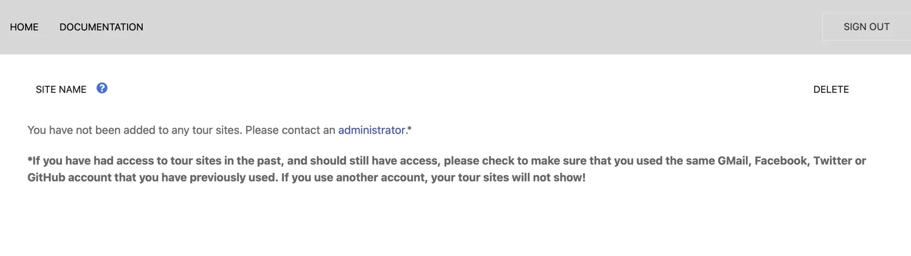
**LOGIN NOTE:** The above message is the CORRECT message for your <strong>first</strong> login.  You MUST contact an admin to get access to a specific Tour Site.  
**COMMON ISSUE:** If you log in and find the above message (*You have not been added to any tour sites. Please contact an administrator.*) instead of your tour site, <em>when you have had access to a tour site in the past</em>, please <strong>first check</strong> that you logged in with *the correct Gmail/Facebook/Github account*. Your OpenTour tour site permissions are tied to the specific email address you use to log in, and if you use a different social media account, you will not be able to access your tour site. OpenTour will add you as a different (new) user!

## Contents:
### 1. [Log in](#1-how-to-log-in "log in")
### 2. [Create a Tour](#2-how-to-create-a-tour "Create a Tour")
### 3. [Add Tour Stops](#3-how-to-add-tour-stops "Tour Stops")
### 4. [Add Tour Pages](#4-how-to-add-tour-pages "Add Tour Pages")
### 5. [How-To Information](#5-additional-how-to-information "Additional How-To")
### 6. [Using OpenTour](#6-using-an-opentour-tour "Using OpenTour")
### 7. [Troubleshooting Problems](#7-troubleshooting "Troubleshooting")

***

### 1. How to Log in. 
 &nbsp;&nbsp;&nbsp;&nbsp;&nbsp;&nbsp;&nbsp;&nbsp;	**Note:** This manual uses Emory University’s installation of OpenTour v. 3.1/4.0 as an example [(Read more about ECDS's OpenTour.)](index.md "ECDS OpenTour").
####  &nbsp;&nbsp;&nbsp;&nbsp;&nbsp;&nbsp;a.	Go to your url + `/admin`.
 &nbsp;&nbsp;&nbsp;&nbsp;&nbsp;&nbsp;&nbsp;&nbsp;&nbsp;&nbsp;&nbsp;&nbsp;i.	for Emory that is [http://opentour.site/admin](http://opentour.site/admin). If you are logging into an Emory hosted tour site, log into https://your-tour-site-name.opentour.site/admin/, replacing *your-tour-site-name* with the url for your Tour Site. 
####  &nbsp;&nbsp;&nbsp;&nbsp;&nbsp;&nbsp;b.	Log in by using your chosen social media account 
 &nbsp;&nbsp;&nbsp;&nbsp;&nbsp;&nbsp;&nbsp;&nbsp;&nbsp;&nbsp;&nbsp;&nbsp;i.	(***this must be the same one that was set up as a user for this tour site***). Click the Red 'G' Google bar for gmail, blue 'f' for Facebook, black Github bar for your Github account, or the light blue Twitter for your Twitter account. 
 &nbsp;&nbsp;&nbsp;&nbsp;&nbsp;&nbsp;&nbsp;&nbsp;&nbsp;&nbsp;&nbsp;&nbsp;ii.	**Note:** this will also log you into gmail/Facebook/Github/Twitter on this browser. If you go to your mail, google, youtube, etc., you will see that. So, you may want to go log out of gmail after you finish working on the tour (particularly on public computers). 
 &nbsp;&nbsp;&nbsp;&nbsp;&nbsp;&nbsp;&nbsp;&nbsp;&nbsp;&nbsp;&nbsp;&nbsp;iii.	**Note:** If you are already logged into Gmail/Facebook/Github/Twitter in the browser that you are using, OpenTour may automatically accept your login without requiring your password a second time, and redirect you automatically to the admin after you choose your account name. 
####  &nbsp;&nbsp;&nbsp;&nbsp;&nbsp;&nbsp;c.	**Login Error**
 &nbsp;&nbsp;&nbsp;&nbsp;&nbsp;&nbsp;&nbsp;&nbsp;&nbsp;&nbsp;&nbsp;&nbsp;i.	*Note:* If you get an error when you try to log in, check to see if you are already logged into Gmail/Facebook/Github/Twitter on another tab, and try logging out before logging back into OpenTour. 
####  &nbsp;&nbsp;&nbsp;&nbsp;&nbsp;&nbsp;d.	**OpenTour Terms of Service agreement** 
 &nbsp;&nbsp;&nbsp;&nbsp;&nbsp;&nbsp;&nbsp;&nbsp;&nbsp;&nbsp;&nbsp;&nbsp;i.	*Note:* The first time you log into the OpenTour app, you will be presented with the OpenTour *Terms of Service agreement*. Agree by clicking 'Agree' at the bottom to proceed. 
####  &nbsp;&nbsp;&nbsp;&nbsp;&nbsp;&nbsp;e.      The login page looks like this:

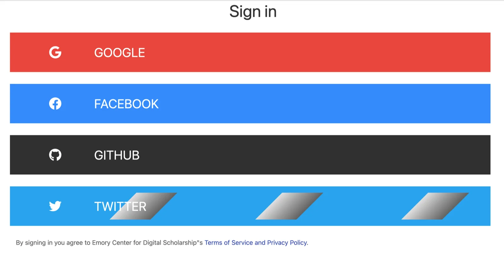

####  &nbsp;&nbsp;&nbsp;&nbsp;&nbsp;&nbsp;f.      Help text (?) in the admin. 
 &nbsp;&nbsp;&nbsp;&nbsp;&nbsp;&nbsp;&nbsp;&nbsp;&nbsp;&nbsp;&nbsp;&nbsp;i.	Once logged in you will periodically see (?) icons with help text. Hover over a (?) icon to reveal help text on the related buttons and elements. 

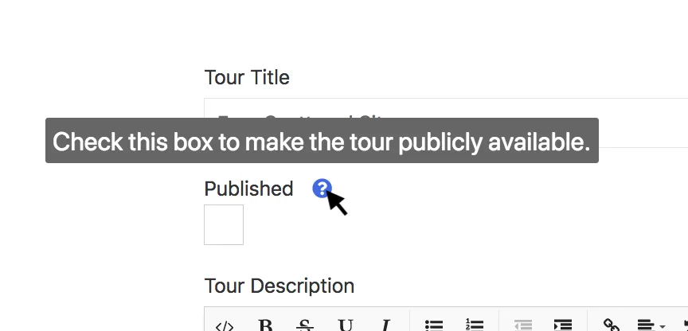

####  &nbsp;&nbsp;&nbsp;&nbsp;&nbsp;&nbsp;g.	**LOGIN NOTE:** May need to refresh after login 
 &nbsp;&nbsp;&nbsp;&nbsp;&nbsp;&nbsp;&nbsp;&nbsp;&nbsp;&nbsp;&nbsp;&nbsp;i.	**LOGIN NOTE:** After you log in, if the page does not automatically refresh, you may have to enter the admin URL again (your url + `admin/`) to get the admin. For Emory [http://opentour.site/admin](http://opentour.site/admin). 
####  &nbsp;&nbsp;&nbsp;&nbsp;&nbsp;&nbsp;h.	**LOGIN NOTE:** Getting access to a Tour Site. 
 &nbsp;&nbsp;&nbsp;&nbsp;&nbsp;&nbsp;&nbsp;&nbsp;&nbsp;&nbsp;&nbsp;&nbsp;i.	**LOGIN NOTE:** The first time you log in you will see the admin message *You have not been added to any tour sites. Please contact an administrator.* You can click on 'administrator' for the Readux admin email address. Once you are added to a tour site, you will see your tour site name in this location. 
####  &nbsp;&nbsp;&nbsp;&nbsp;&nbsp;&nbsp;i.	**COMMON ISSUE:** If you log in and find the above message (also pictured in image below) instead of your tour site, when you have had access to a tour site in the past, *please first check that you logged in with the correct Gmail/Facebook/Github account*. Your OpenTour tour site permissions are tied to the specific email address you use to log in, and if you use a different social media account, you will not be able to access your tour site. OpenTour will register you as a different (new) user!

####  &nbsp;&nbsp;&nbsp;&nbsp;&nbsp;&nbsp;j.	The Documentation link available in the header brings the user to this guide for help.
### 2. How to Create a Tour.
####  &nbsp;&nbsp;&nbsp;&nbsp;&nbsp;&nbsp;a.	Once you are logged-in, go to your “Tour Site”.  
 &nbsp;&nbsp;&nbsp;&nbsp;&nbsp;&nbsp;&nbsp;&nbsp;&nbsp;&nbsp;&nbsp;&nbsp;i.	All your work will stay within your named Tour Site. The name of your tour site will also be the URL to which visitors will go.   
  &nbsp;&nbsp;&nbsp;&nbsp;&nbsp;&nbsp;&nbsp;&nbsp;&nbsp;&nbsp;&nbsp;&nbsp;ii.	E.g. *http://tour-site-name.opentour.site/* will be the URL for tours created in the tour site called “Tour Site Name”.  
  &nbsp;&nbsp;&nbsp;&nbsp;&nbsp;&nbsp;&nbsp;&nbsp;&nbsp;&nbsp;&nbsp;&nbsp;iii.	The name of your tour site should fit on one line on a mobile phone for best legibility. This will be under 25 characters on most mobile phones and we recommend around 22 characters or shorter.

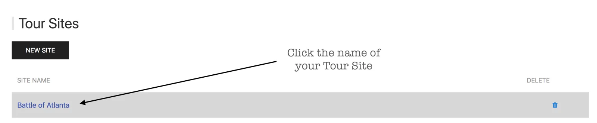

####  &nbsp;&nbsp;&nbsp;&nbsp;&nbsp;&nbsp;b.	**Sharing the site:** Take care and be kind to other users.
 &nbsp;&nbsp;&nbsp;&nbsp;&nbsp;&nbsp;&nbsp;&nbsp;&nbsp;&nbsp;&nbsp;&nbsp;i.	You should not be able to access other tour sites, but if you have access to multiple projects, *Do NOT* try to create a new tour outside of your current tour site. *Do NOT* try to create a tour from the main admin page before clicking on your tour site. **Do NOT edit, delete, or otherwise alter the tours of other users** who may share your tour site. 

####  &nbsp;&nbsp;&nbsp;&nbsp;&nbsp;&nbsp;c.	Once you are in your Tour Site, you have a few options.
  &nbsp;&nbsp;&nbsp;&nbsp;&nbsp;&nbsp;&nbsp;&nbsp;&nbsp;&nbsp;&nbsp;&nbsp;i.	You can choose the **“New Tour”** button to create a tour! 
  &nbsp;&nbsp;&nbsp;&nbsp;&nbsp;&nbsp;&nbsp;&nbsp;&nbsp;&nbsp;&nbsp;&nbsp;ii.	If you already created your tour, **click on its name** to edit it. 
  &nbsp;&nbsp;&nbsp;&nbsp;&nbsp;&nbsp;&nbsp;&nbsp;&nbsp;&nbsp;&nbsp;&nbsp;iii.	You can add a **unique logo** to your tour site, which will show in the top left corner of your tour site in the public view. Just click on 'Upload site logo' and choose an appropriately sized image file.

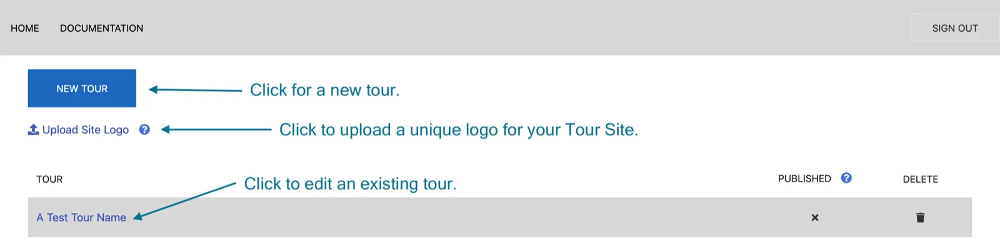

####  &nbsp;&nbsp;&nbsp;&nbsp;&nbsp;&nbsp;d.	Clicking on 'New Tour' brings up the edit a tour menu.  
  &nbsp;&nbsp;&nbsp;&nbsp;&nbsp;&nbsp;&nbsp;&nbsp;&nbsp;&nbsp;&nbsp;&nbsp;i.	It has a number of basic fields to get your tour started.  First, we will look at the fields for creating the main tour landing page. 

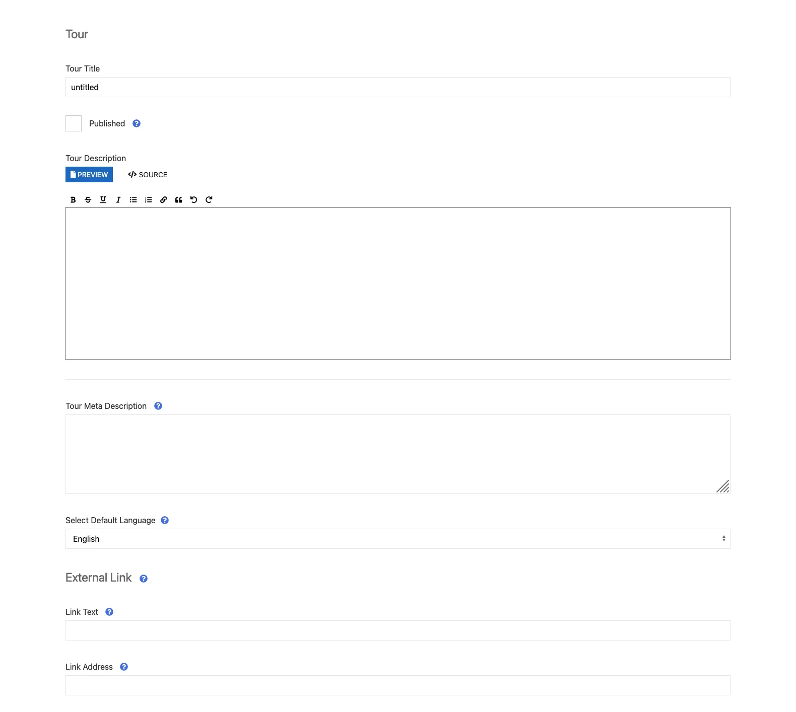

####  &nbsp;&nbsp;&nbsp;&nbsp;&nbsp;&nbsp;e.	To begin creating your tour, enter your Tour Title.  
  &nbsp;&nbsp;&nbsp;&nbsp;&nbsp;&nbsp;&nbsp;&nbsp;&nbsp;&nbsp;&nbsp;&nbsp;i.	Keep in mind that it should be short and clear.  It needs to fit on the width of a mobile phone, which limits the number of descriptive words you can use. The maximum number of characters is 38, which in some cases may be too long. We recommend keeping your tour title to around 30 characters or less. 
####  &nbsp;&nbsp;&nbsp;&nbsp;&nbsp;&nbsp;f.	Below “Tour Title” you will see the word “published” and a checkbox.  
  &nbsp;&nbsp;&nbsp;&nbsp;&nbsp;&nbsp;&nbsp;&nbsp;&nbsp;&nbsp;&nbsp;&nbsp;i.	**Do not** select this checkbox until you are certain you want the tour to be publicly visible.  You can continue to work on the tour, edit it, and see what it looks like, at any point when you are logged into the site, even before it is published. You will also be able to edit the tour after it is published. 
####  &nbsp;&nbsp;&nbsp;&nbsp;&nbsp;&nbsp;g.	The next field is your “Tour Description.” 
  &nbsp;&nbsp;&nbsp;&nbsp;&nbsp;&nbsp;&nbsp;&nbsp;&nbsp;&nbsp;&nbsp;&nbsp;i.	Your “Tour Description” can be much longer than your Title.  This field can include a text description. It should not be too long, as again it needs to be read on a mobile phone screen, however, scrolling allows for a few paragraphs.  This section introduces your tour and its purpose.  The text is entered in a basic wysiwyg editor (like working in a basic text editor). 
  &nbsp;&nbsp;&nbsp;&nbsp;&nbsp;&nbsp;&nbsp;&nbsp;&nbsp;&nbsp;&nbsp;&nbsp;ii.	The “html” tab `[</> SOURCE]`, located next to the `PREVIEW` tab, allows you to edit the html of your text directly. You do not have to use this, but if you want additional styling of your text, you can use this tab. It allows you to iframe content if needed or minimally change styles. Go to [How-To Information](#5-additional-how-to-information "Additional How-To") for how to use iframes. 
  &nbsp;&nbsp;&nbsp;&nbsp;&nbsp;&nbsp;&nbsp;&nbsp;&nbsp;&nbsp;&nbsp;&nbsp;iii.	There are also other helpers for **bold text**, *italics*, underline, strike-through, lists, and adding external or internal links with the chain/link icon. 
  &nbsp;&nbsp;&nbsp;&nbsp;&nbsp;&nbsp;&nbsp;&nbsp;&nbsp;&nbsp;&nbsp;&nbsp;iv.	**Note:** After entering your tour description, add a couple of carriage returns (hit enter a couple of times) to leave some white space after your paragraph-text. This will make reading your tour text easier on a mobile device.
####  &nbsp;&nbsp;&nbsp;&nbsp;&nbsp;&nbsp;h.	Next is the “Tour Meta Description”. 
  &nbsp;&nbsp;&nbsp;&nbsp;&nbsp;&nbsp;&nbsp;&nbsp;&nbsp;&nbsp;&nbsp;&nbsp;i.	The Tour Meta Description is the text that would show up if someone found your tour by means of a search engine, like Google, or if the tour is shared on social media, like Twitter.  It can be the same as the tour description or shorter and simpler, but cannot have styles (bold, italics, etc.). 
####  &nbsp;&nbsp;&nbsp;&nbsp;&nbsp;&nbsp;i.	*New in 3.1* On mobile devices you can click the audio (headset) icon and a computer voice reads out the text.  
  &nbsp;&nbsp;&nbsp;&nbsp;&nbsp;&nbsp;&nbsp;&nbsp;&nbsp;&nbsp;&nbsp;&nbsp;i.	Find out more about [audio accessibility](#6-using-an-opentour-tour "Audio"). New in OpenTour 3.1, you can select in which language the voice reads the text. The default is English, but many other options are available, so that a tour in (for example) Spanish will be read correctly. 
####  &nbsp;&nbsp;&nbsp;&nbsp;&nbsp;&nbsp;j. *Updated in 4.0* Desktop and Mobile header and Links: 
  &nbsp;&nbsp;&nbsp;&nbsp;&nbsp;&nbsp;&nbsp;&nbsp;&nbsp;&nbsp;&nbsp;&nbsp;i.	In the header on a desktop tour and in the side menu on a mobile tour, the user can find links to the Tour Site home, the main page of the tour, and any 'Pages' on the tour. New in OpenTour 3.1, you can also *add an external link* to this menu. This allows you to link directly to your organization's homepage from a tour. New in OpenTour 4.0, in the mobile menu you will have a link to the Stops page of your tour, so you can return to the stops list at any time. 
  &nbsp;&nbsp;&nbsp;&nbsp;&nbsp;&nbsp;&nbsp;&nbsp;&nbsp;&nbsp;&nbsp;&nbsp;ii.	To enter the link, fill out both the "Link Text" - the word or phrase that shows up on the menu - and the "Link Address" - the URL to your website. 

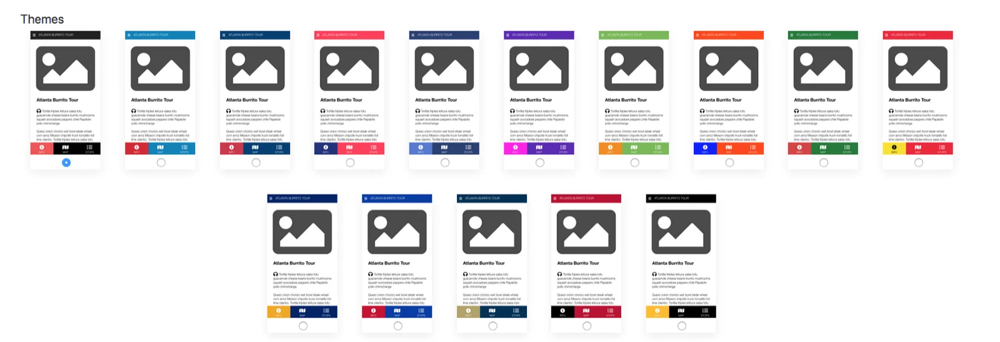

####  &nbsp;&nbsp;&nbsp;&nbsp;&nbsp;&nbsp;k.	Color theme selection for your tour.
  &nbsp;&nbsp;&nbsp;&nbsp;&nbsp;&nbsp;&nbsp;&nbsp;&nbsp;&nbsp;&nbsp;&nbsp;i.	Then an array of buttons allows you to select which of OpenTour’s color themes you want your users to see during mobile view. There are a variety of options to coordinate with different tours. Choose one theme for the entire tour by clicking on the icon of that color set (menu and highlighted button colors). This sets the tour color theme for all the tour screens in mobile view. 

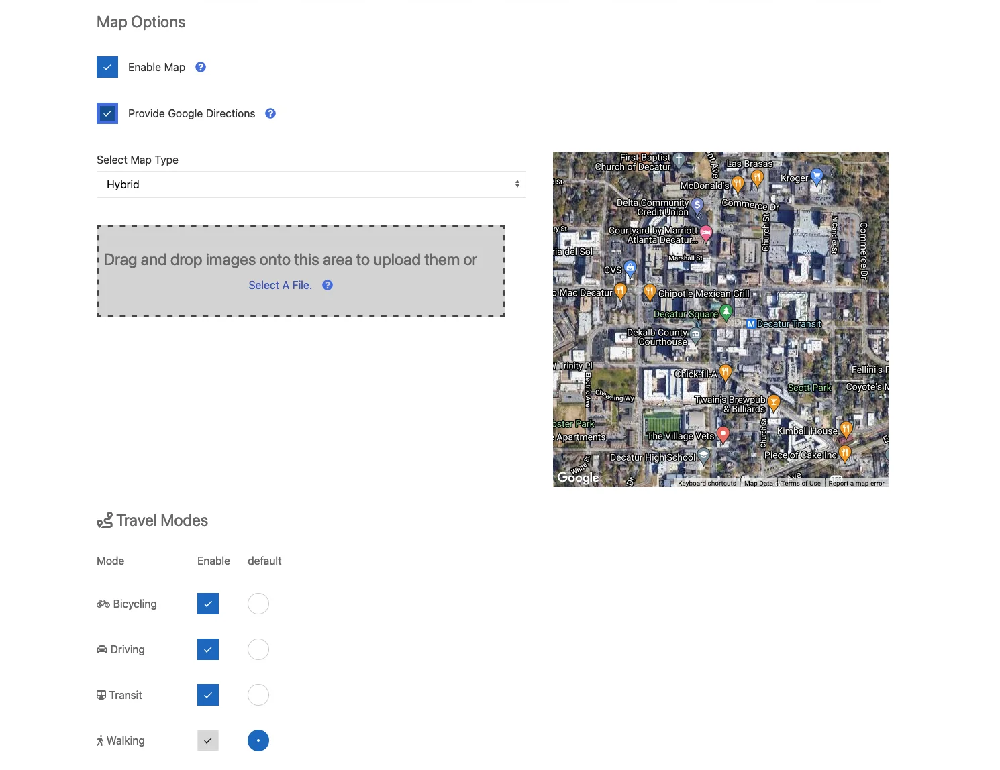

####  &nbsp;&nbsp;&nbsp;&nbsp;&nbsp;&nbsp;l.	Map options for your tour
  &nbsp;&nbsp;&nbsp;&nbsp;&nbsp;&nbsp;&nbsp;&nbsp;&nbsp;&nbsp;&nbsp;&nbsp;i.	OpenTour provides a few map options, some of which are new in OpenTour 3.1. The first two options are checkboxes, which let you choose what type of tour you want to create. 
  &nbsp;&nbsp;&nbsp;&nbsp;&nbsp;&nbsp;&nbsp;&nbsp;&nbsp;&nbsp;&nbsp;&nbsp;ii.	First you can choose whether or not you want to enable the map. If not checked, you would create a tour just of scrolling text without geographical references. 
  &nbsp;&nbsp;&nbsp;&nbsp;&nbsp;&nbsp;&nbsp;&nbsp;&nbsp;&nbsp;&nbsp;&nbsp;iii.	Second, you can separately choose whether to provide Google directions. This is only an option when the map is enabled. If the map is enabled, you still might not want Google directions. Google directions help get your users from stop to stop on your tour. However, if you are creating a tour with stops in broadly distant locations, you may not be expecting users to travel them. Additionally, if you create a tour which is inside of a building, Google directions will not be able to provide useful information. Finally, if you use the new feature to overlay an image or map on top of the Google map (see below), you will likely not need directions.
####  &nbsp;&nbsp;&nbsp;&nbsp;&nbsp;&nbsp;m.	Basemap options for your tour.
  &nbsp;&nbsp;&nbsp;&nbsp;&nbsp;&nbsp;&nbsp;&nbsp;&nbsp;&nbsp;&nbsp;&nbsp;i.	Then a small dropdown menu allows you to select which of Google’s basemaps you want your users to see.  The options are roadmap, satellite, hybrid, and terrain. This sets the basemap for all the tour screens. 
####  &nbsp;&nbsp;&nbsp;&nbsp;&nbsp;&nbsp;n.	*New in 3.1* Overlay a historical map or image on the basemap.
  &nbsp;&nbsp;&nbsp;&nbsp;&nbsp;&nbsp;&nbsp;&nbsp;&nbsp;&nbsp;&nbsp;&nbsp;i.	*New in 3.1* You can now choose to overlay an image or map over the Google map in OpenTour. This allows you to use historical maps on your tour, to create tours of fictional places, or to even create a "tour" of an artwork. 
  &nbsp;&nbsp;&nbsp;&nbsp;&nbsp;&nbsp;&nbsp;&nbsp;&nbsp;&nbsp;&nbsp;&nbsp;ii.	Just *click on Select A File* in the gray box, and choose your image. 
  &nbsp;&nbsp;&nbsp;&nbsp;&nbsp;&nbsp;&nbsp;&nbsp;&nbsp;&nbsp;&nbsp;&nbsp;iii. Once you have uploaded your image, you will see it over the map on the right. There are four large circles, one at each corner.  You can click and drag any of the circles to resize the map or image. 

  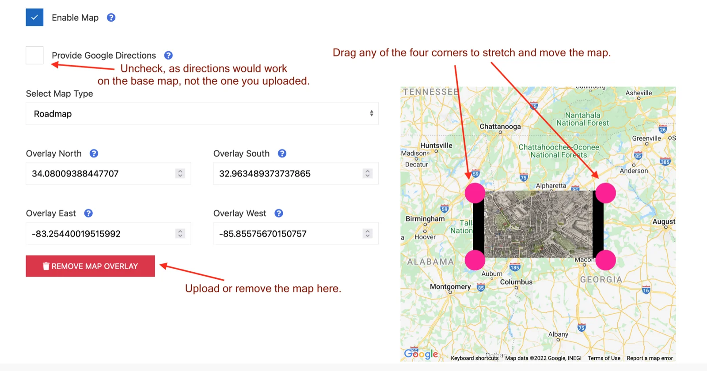

  &nbsp;&nbsp;&nbsp;&nbsp;&nbsp;&nbsp;&nbsp;&nbsp;&nbsp;&nbsp;&nbsp;&nbsp;iv. ***Tip*** If you want to have the map display at an angle, you can rotate the map in an external software, such as Photoshop, and save it with a transparent background as a .png file. The transparent sections will show the Google map. 
  &nbsp;&nbsp;&nbsp;&nbsp;&nbsp;&nbsp;&nbsp;&nbsp;&nbsp;&nbsp;&nbsp;&nbsp;v. The map will now also show in any stops that you create in the admin, so that you can position your points over the overlay map. 
  &nbsp;&nbsp;&nbsp;&nbsp;&nbsp;&nbsp;&nbsp;&nbsp;&nbsp;&nbsp;&nbsp;&nbsp;vi. ***Tip*** Keep in mind where the points go on your map, so that you have a border of map around them.

  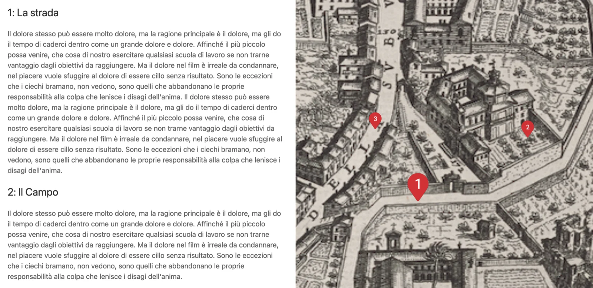

####  &nbsp;&nbsp;&nbsp;&nbsp;&nbsp;&nbsp;o.	Next the Travel Modes section 
  &nbsp;&nbsp;&nbsp;&nbsp;&nbsp;&nbsp;&nbsp;&nbsp;&nbsp;&nbsp;&nbsp;&nbsp;i.	Travel modes allows you to select which of Google’s travel modes you want your users to see when they are getting directions. 
  &nbsp;&nbsp;&nbsp;&nbsp;&nbsp;&nbsp;&nbsp;&nbsp;&nbsp;&nbsp;&nbsp;&nbsp;ii.	The options are Walking, Bicycling, Driving, and Transit. In many cases you may want to only show users a couple of relevant options, instead of all four. On the front end they will be able to choose between whichever of these four modes you enable.  Enable a mode by checking the check-box (square) to its right, under the Enable column.  
  &nbsp;&nbsp;&nbsp;&nbsp;&nbsp;&nbsp;&nbsp;&nbsp;&nbsp;&nbsp;&nbsp;&nbsp;iii.	In this section you also set the default mode, which shows up without user interaction for all your tour stops. To choose a default mode, check the radio button (circle) to the right of the mode, in the Default column. 

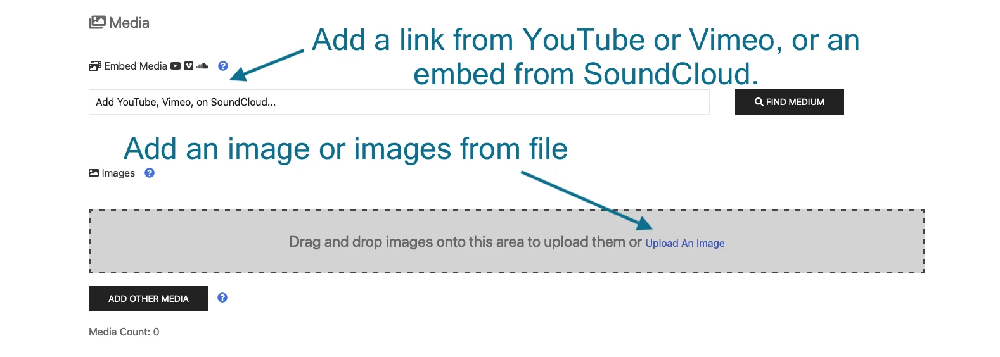

####  &nbsp;&nbsp;&nbsp;&nbsp;&nbsp;&nbsp;n.	Media slider - inputting images and media.
  &nbsp;&nbsp;&nbsp;&nbsp;&nbsp;&nbsp;&nbsp;&nbsp;&nbsp;&nbsp;&nbsp;&nbsp;i.	Below this, the final section of your main tour page is the media section.  Your options are “Embed Media” and “Images”.  All images and videos that you upload and attach will appear in a slider at the top of your main tour page.  You can upload as many as you want with the understanding that it needs to be a reasonable number for a visitor to scroll through. 
  &nbsp;&nbsp;&nbsp;&nbsp;&nbsp;&nbsp;&nbsp;&nbsp;&nbsp;&nbsp;&nbsp;&nbsp;ii.	**Embed media** – To add a video or audio clip, you need to link the video from Vimeo or YouTube, or get the embed code from SoundCloud.  Add the video’s share link, or SoundCloud clip's audio embed link to the “Add YouTube, Vimeo, on SoundCloud...” line.  Once you have pasted or typed in the link, you should see the image of the media below and the button "Yes! Add this Media" below it.  Click that button to add the media as a media item to your Tour’s home page.  Replace the link if the wrong video or clip appears.  If a video or clip does not appear, and the button does not show up, the link is not correct, or the video or audio is hosted on an unsupported platform. See notes and tips below (iv-vii.). **NOTE** - While you can use the URL for YouTube and Vimeo, you must use the embed code `<iframe ...>` for SoundCloud. 

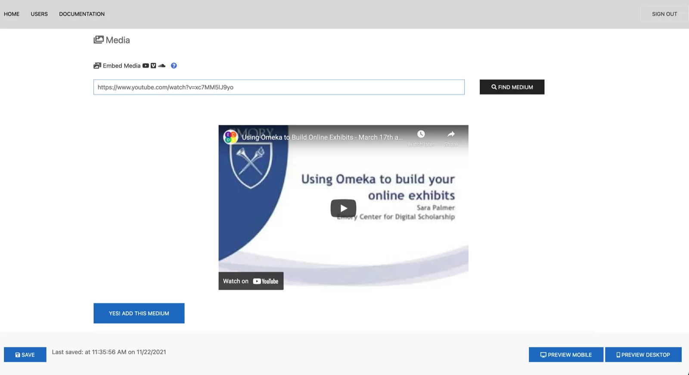

  &nbsp;&nbsp;&nbsp;&nbsp;&nbsp;&nbsp;&nbsp;&nbsp;&nbsp;&nbsp;&nbsp;&nbsp;iii.	**Add Images** – To add images, go to the section “Drag and drop images onto this area to upload them or Upload an Image” and click “Upload an Image”.  Select the image that you want from your computer and click “Save”. **Note** The images will show full width in a 16:9 image ratio. A 4:3 image will have a white border on two sides. Any sized image can fit, however.

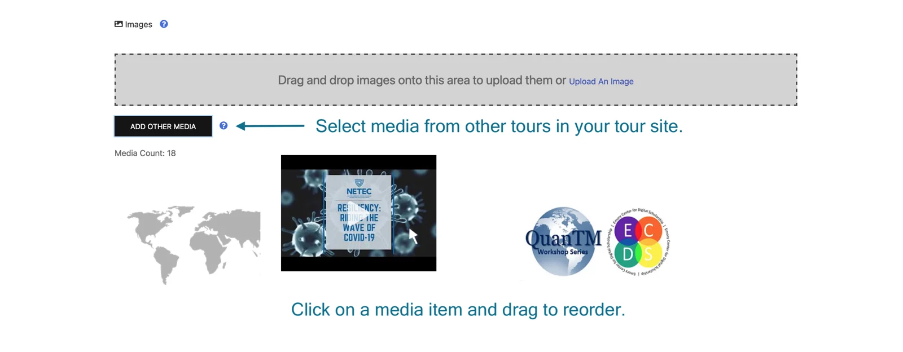

  &nbsp;&nbsp;&nbsp;&nbsp;&nbsp;&nbsp;&nbsp;&nbsp;&nbsp;&nbsp;&nbsp;&nbsp;iv.	Reordering media items: Your media will all show up as tiles under “Media Count”.  You can click and drag to reorder them.  You can include as many images or videos in any order as you want. The will auto-save and renumber their order. 
  &nbsp;&nbsp;&nbsp;&nbsp;&nbsp;&nbsp;&nbsp;&nbsp;&nbsp;&nbsp;&nbsp;&nbsp;v.	If you click on the “Edit” button on an image, video, or media item you can enter the “title” that you want to show up under the media item on the public tour page, and the “caption” that you want to show when a user clicks on the image. The caption is a good place to include licensing and copyright information about images. 

  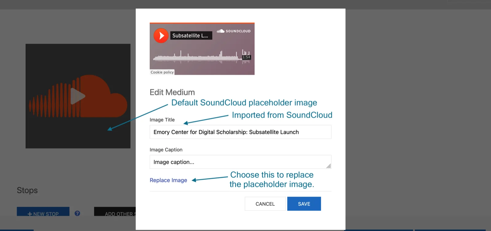

  &nbsp;&nbsp;&nbsp;&nbsp;&nbsp;&nbsp;&nbsp;&nbsp;&nbsp;&nbsp;&nbsp;&nbsp;vi.	**NOTE** - For videos and audio clips from YouTube, Vimeo, and SoundCloud, the title and caption will be imported from the host site. You can edit the text once it has imported to your video or audio clip. 
  &nbsp;&nbsp;&nbsp;&nbsp;&nbsp;&nbsp;&nbsp;&nbsp;&nbsp;&nbsp;&nbsp;&nbsp;vii.	**NOTE** - SoundCloud audio will import with the default SoundCloud image. If you want to replace the image with a relevant image file, you can click on 'Edit' under the media item, and 'Replace Image' on the Media metadata page. You can also replace the thumbnails imported from Vimeo or YouTube. 
  &nbsp;&nbsp;&nbsp;&nbsp;&nbsp;&nbsp;&nbsp;&nbsp;&nbsp;&nbsp;&nbsp;&nbsp;viii.	**TIP** - If you import a video from Vimeo that is shared by Private link, it may not correctly import the thumbnail. Use the above (vi.) 'Replace Image' button to add a thumbnail. 
  &nbsp;&nbsp;&nbsp;&nbsp;&nbsp;&nbsp;&nbsp;&nbsp;&nbsp;&nbsp;&nbsp;&nbsp;ix. Click the **ADD OTHER MEDIA** button to add images, video, or audio, to your tour that you have already uploaded or embedded on another tour in your tour site. You will get to choose from a list of all media that has already been uploaded.
####  &nbsp;&nbsp;&nbsp;&nbsp;&nbsp;&nbsp;o.	Saving Your Work - and Previewing the Tour.
  &nbsp;&nbsp;&nbsp;&nbsp;&nbsp;&nbsp;&nbsp;&nbsp;&nbsp;&nbsp;&nbsp;&nbsp;i.	Now that you have entered all the data and media for the tour’s landing page, you can save your work and preview.  You can also move on to adding stops.  In either case, save your work by clicking “Save” at the bottom of the page to save the tour. 
  &nbsp;&nbsp;&nbsp;&nbsp;&nbsp;&nbsp;&nbsp;&nbsp;&nbsp;&nbsp;&nbsp;&nbsp;ii.	**Note:** Some actions, like adding media or reordering media, automatically save the tour. The tour also periodically auto-saves (new in version 3.1).  It is always best to click “Save” after any work! Also keep in mind that not clicking “Save” does not mean that your changes have been undone.  Always check the public tour page after working. 
####  &nbsp;&nbsp;&nbsp;&nbsp;&nbsp;&nbsp;p.	**New in 4.0** Linking to a media slider image or media item.
  &nbsp;&nbsp;&nbsp;&nbsp;&nbsp;&nbsp;&nbsp;&nbsp;&nbsp;&nbsp;&nbsp;&nbsp;i.	Once you have uploaded and saved your media item, you can get a link to that item. You can use that link within your stop text (or elsewhere in your tour), to link back to you image or media as an illustration.  
  &nbsp;&nbsp;&nbsp;&nbsp;&nbsp;&nbsp;&nbsp;&nbsp;&nbsp;&nbsp;&nbsp;&nbsp;ii.    To link to an image, preview the tour, or go to its public facing side. Click on the image or media item in your media slider, so that its pop-up appears. Two links appear in the bottom left of the image. Click "Copy Link", and the link to the media item will be saved to your clipboard. You can then go back to editing your text, and use the link to link to that media item. 

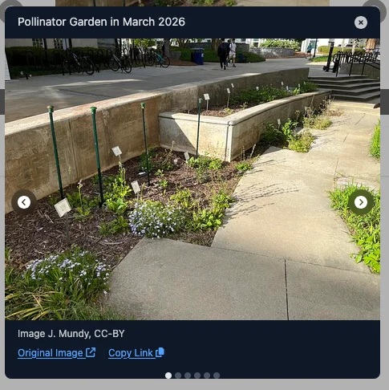

### 3. How to Add Tour Stops:
####  &nbsp;&nbsp;&nbsp;&nbsp;&nbsp;&nbsp;a.	Click “New Stop”.  You will be presented with a blank stop form.      
 &nbsp;&nbsp;&nbsp;&nbsp;&nbsp;&nbsp;&nbsp;&nbsp;&nbsp;&nbsp;&nbsp;&nbsp;i.	If you have created a stop already in another tour within your Tour Site, you can click **ADD OTHER STOPS** to bring a copy or duplicate of the stop to this tour. This may be useful if you are doing multiple tours of a single area, and want to have a few stops overlap. Once you click **ADD OTHER STOPS**, you will get a list of all the stop in your Tour Site. For each stop, you can choose either to **"Add+"** the stop to your tour, so that any edits to the stop would show up in all tours, or to **"Copy"** to the stop to your tour, so that you can make minor adjustments that show up only in this tour. 

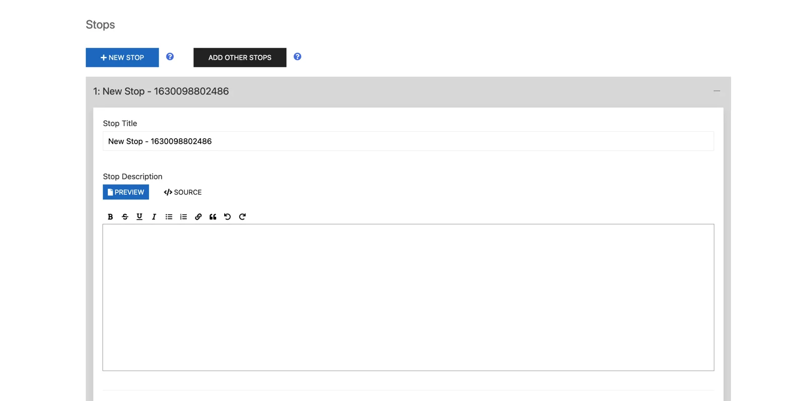

####  &nbsp;&nbsp;&nbsp;&nbsp;&nbsp;&nbsp;b.	Many of the fields for stops are similar to those we saw on the main tour landing page.
####  &nbsp;&nbsp;&nbsp;&nbsp;&nbsp;&nbsp;c.	First, you can add the “Stop Title” and “Stop Description.”  
  &nbsp;&nbsp;&nbsp;&nbsp;&nbsp;&nbsp;&nbsp;&nbsp;&nbsp;&nbsp;&nbsp;&nbsp;i.	These function the same as they do on the landing page.  The title should be short enough to fit on a mobile phone.  
  &nbsp;&nbsp;&nbsp;&nbsp;&nbsp;&nbsp;&nbsp;&nbsp;&nbsp;&nbsp;&nbsp;&nbsp;ii.	**Note:** Make sure the stop name is unique.  It also serves as the slug for the URL for the stop, so do not choose “Stop 1” or “Start” if you might use that in another tour. 
  &nbsp;&nbsp;&nbsp;&nbsp;&nbsp;&nbsp;&nbsp;&nbsp;&nbsp;&nbsp;&nbsp;&nbsp;iii.	The Description field has the same basic text editor.  You can use the “html” tab `[</> SOURCE]` for any iframe or basic style changes that you want to show up on the stop page. Go to [How-To Information](#5-additional-how-to-information "Additional How-To") for how to use iframes. 
  &nbsp;&nbsp;&nbsp;&nbsp;&nbsp;&nbsp;&nbsp;&nbsp;&nbsp;&nbsp;&nbsp;&nbsp;iv.	**Note:** It is recommended that you not copy-paste in text directly from Microsoft Word. Word saves its text with complicated style code, which will also be pasted unnecessarily into the page. Try pasting the text that you have written up in Word or Google Docs into a plain text editor and then copy-paste into the tour from there. 
  &nbsp;&nbsp;&nbsp;&nbsp;&nbsp;&nbsp;&nbsp;&nbsp;&nbsp;&nbsp;&nbsp;&nbsp;v.	While you can include images in the Description field (text editor) through the “html” tab `[</> SOURCE]` or through pasting from Word, it is recommended that you put images into your stop through the Manage Media portion of the tour stop (see [i. below](#i-manage-media "Manage Media")). This section will add the images to the slider at the top of each stop and will size them correctly by default for different viewers. 
####  &nbsp;&nbsp;&nbsp;&nbsp;&nbsp;&nbsp;d.	Add the Stop Meta Description.  
  &nbsp;&nbsp;&nbsp;&nbsp;&nbsp;&nbsp;&nbsp;&nbsp;&nbsp;&nbsp;&nbsp;&nbsp;i.	This is the description that will be visible if you share a stop on social media. 
  &nbsp;&nbsp;&nbsp;&nbsp;&nbsp;&nbsp;&nbsp;&nbsp;&nbsp;&nbsp;&nbsp;&nbsp;ii.	**NOTE:** The stop meta description *must* be less than 500 characters. As this is used for social media posts and search engines, more characters would never show. This also cannot include any styling, just text. 
####  &nbsp;&nbsp;&nbsp;&nbsp;&nbsp;&nbsp;e.	Stop location/address/position input.
  &nbsp;&nbsp;&nbsp;&nbsp;&nbsp;&nbsp;&nbsp;&nbsp;&nbsp;&nbsp;&nbsp;&nbsp;i.	The place where stops differ from the landing page is in the location and mapping information.  You will see the field “Stop Address” where you can enter the data for the physical location of your tour stop. 
  &nbsp;&nbsp;&nbsp;&nbsp;&nbsp;&nbsp;&nbsp;&nbsp;&nbsp;&nbsp;&nbsp;&nbsp;ii.	**LOCATION NOTE:** You **MUST** enter a location for each tour stop. If you do not enter your own location, the map will default the first stop on a tour to the Latitude/Longitude of the center of Atlanta, subsequent stops will default to the location of the previous stop. This is new in OpenTour 3.1, OpenTour 3.0 centered blank stops at a Lat/Long of 0,0. Keep your stop locations in mind.   
  &nbsp;&nbsp;&nbsp;&nbsp;&nbsp;&nbsp;&nbsp;&nbsp;&nbsp;&nbsp;&nbsp;&nbsp;iii.	**LOCATION NOTE:** You **MUST** have a number on both the latitude and longitude lines for each tour stop (the default with no changes is Latitude/Longitude of 33.75432,-84.38979 – located in the middle of Atlanta). If you delete these numbers, and do not have another latitude and longitude the map will not display. These lines cannot be blank. If you enter an address and click “Locate Address” the lat/long will populate for you. If you adjust the position on the map of your point, the lat/long will adjust automatically. 
  &nbsp;&nbsp;&nbsp;&nbsp;&nbsp;&nbsp;&nbsp;&nbsp;&nbsp;&nbsp;&nbsp;&nbsp;iv.	**Suggestion:** If you want to have a stop without a position, enter the same position as you did for the previous stop, and this will allow the user to understand his or her position on the map.  

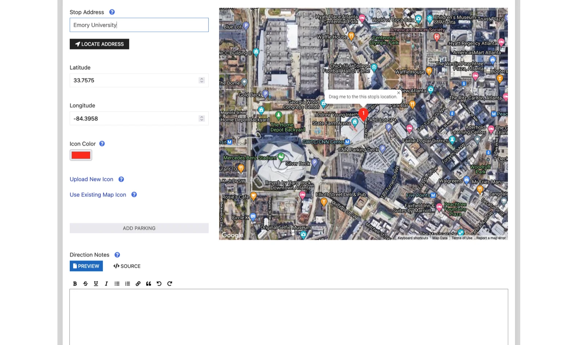

####  &nbsp;&nbsp;&nbsp;&nbsp;&nbsp;&nbsp;f.	Location information:
  &nbsp;&nbsp;&nbsp;&nbsp;&nbsp;&nbsp;&nbsp;&nbsp;&nbsp;&nbsp;&nbsp;&nbsp;i.	Type in the Stop Address and click “Locate Address.”  A point at that address will appear on the preview map, a google map to the right, and the Latitude and Longitude fields below will populate based on the address. 
  &nbsp;&nbsp;&nbsp;&nbsp;&nbsp;&nbsp;&nbsp;&nbsp;&nbsp;&nbsp;&nbsp;&nbsp;ii.	If you instead know the Latitude and Longitude, you can type the latitude and longitude into these fields directly and then click "Locate Address." A point will appear on the preview map, once both numbers are entered. 
  &nbsp;&nbsp;&nbsp;&nbsp;&nbsp;&nbsp;&nbsp;&nbsp;&nbsp;&nbsp;&nbsp;&nbsp;iii.	In either case, once the point has appeared on the preview map, you can click the point and drag to adjust its location on the map. This will update **BOTH** the address **AND** the Lat/Long. 
  &nbsp;&nbsp;&nbsp;&nbsp;&nbsp;&nbsp;&nbsp;&nbsp;&nbsp;&nbsp;&nbsp;&nbsp;iv.	**Make sure** to click "Locate Address" and "Save" on the stop after entering or updating an address or Latitude and Longitude. While it will show the updated address on the preview map, you must click both "Locate Address" and "Save" for the public view to update. 
  &nbsp;&nbsp;&nbsp;&nbsp;&nbsp;&nbsp;&nbsp;&nbsp;&nbsp;&nbsp;&nbsp;&nbsp;v.	***New in 3.1*** You can change the color of the map point marker. Click "Icon Color" to choose a different color for the icon of just that stop. If you want to distinguish certain stops from others (for example, still existing historical sites vs. lost sites), you can color all of one type its own color and put an explanation of the color in the tour description. 
  &nbsp;&nbsp;&nbsp;&nbsp;&nbsp;&nbsp;&nbsp;&nbsp;&nbsp;&nbsp;&nbsp;&nbsp;vi.	***New in 3.1*** You can also upload a stop pointer icon. If you want to use a custom icon, rather than the standarded stop flag, to mark specific stops, you can click "Upload New Icon". The stop icons need to be smaller than 80 x 80 pixels. If you want to use the same custom stop icon on more than one stop, you can upload it on your first use, and use "Use Existing Map icon" for future stops, where you will be able to choose your icon from a list.
####  &nbsp;&nbsp;&nbsp;&nbsp;&nbsp;&nbsp;g.	Parking:
  &nbsp;&nbsp;&nbsp;&nbsp;&nbsp;&nbsp;&nbsp;&nbsp;&nbsp;&nbsp;&nbsp;&nbsp;i.	If your stop has a specific location for parking, separate from the stop location itself (that the directions will need to take into account), click on “Add Parking Location”. 
  &nbsp;&nbsp;&nbsp;&nbsp;&nbsp;&nbsp;&nbsp;&nbsp;&nbsp;&nbsp;&nbsp;&nbsp;ii.	This will open a section with three new fields.  Add the address or Latitude and Longitude of the parking location as you did for the stop above. 
  &nbsp;&nbsp;&nbsp;&nbsp;&nbsp;&nbsp;&nbsp;&nbsp;&nbsp;&nbsp;&nbsp;&nbsp;iii.	After refreshing the page, the parking location can also be edited on the map by clicking and dragging it. It shows as a blue “P” icon on the map. 
####  &nbsp;&nbsp;&nbsp;&nbsp;&nbsp;&nbsp;h.	Direction Notes field:
  &nbsp;&nbsp;&nbsp;&nbsp;&nbsp;&nbsp;&nbsp;&nbsp;&nbsp;&nbsp;&nbsp;&nbsp;i.	If your stop has additional verbose directions that you would like to add, this field (with a basic text editor) will allow you to add them.  This can include any additional information, such as “walk past the large oak tree” or “turn left at the Big Chicken”.  It will show up in a tab under “Directions” next to the tab for turn by turn directions added by google. The tab will not appear if the field is left blank. 

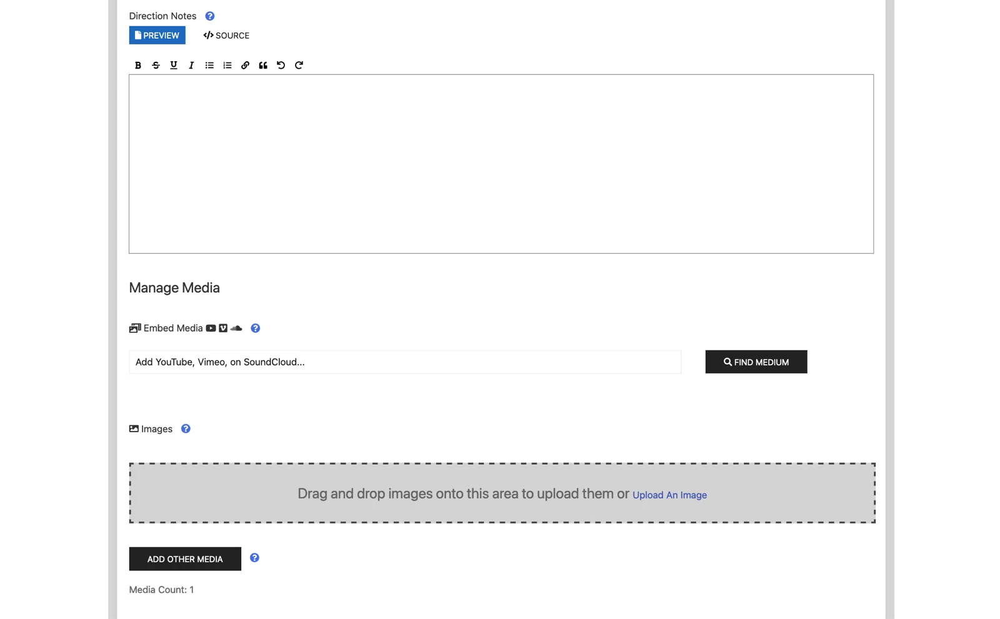

####  &nbsp;&nbsp;&nbsp;&nbsp;&nbsp;&nbsp;i.	Manage Media:
  &nbsp;&nbsp;&nbsp;&nbsp;&nbsp;&nbsp;&nbsp;&nbsp;&nbsp;&nbsp;&nbsp;&nbsp;i.	The manage media functions the same for stops as it does for the main tour page.  You can add videos by YouTube or Vimeo link, audio by SoundCloud embed, or upload image files.  You can reorder any image or video by clicking and dragging. You can add media items from other tours in your Tour Site with the "ADD OTHER MEDIA" button. 
####  &nbsp;&nbsp;&nbsp;&nbsp;&nbsp;&nbsp;j.	Click the “SAVE” button at the bottom of the STOP to save the stop data.
  &nbsp;&nbsp;&nbsp;&nbsp;&nbsp;&nbsp;&nbsp;&nbsp;&nbsp;&nbsp;&nbsp;&nbsp;i.	**NOTE:** It is always best practice to click the stop and tour "SAVE" buttons. While the tour auto-saves, and the overall tour "SAVE" button should save everything, best practice is to click the stop "SAVE" as well to be sure. 
####  &nbsp;&nbsp;&nbsp;&nbsp;&nbsp;&nbsp;k.	Add more stops and then click “Save” at the bottom of the overall tour page.
####  &nbsp;&nbsp;&nbsp;&nbsp;&nbsp;&nbsp;l.	Ordering and reordering your stops (it's easy!)
  &nbsp;&nbsp;&nbsp;&nbsp;&nbsp;&nbsp;&nbsp;&nbsp;&nbsp;&nbsp;&nbsp;&nbsp;i.	You can reorder your stops, and they will renumber automatically. Click on the stop whose position you want to change, and holding down the mouse button, drag it above or below the stop that you want it to go before or after. For example in the sample image below, you can click on stop 6 and drag it above stop 5. This will automatically renumber stop 6 to stop 5. 

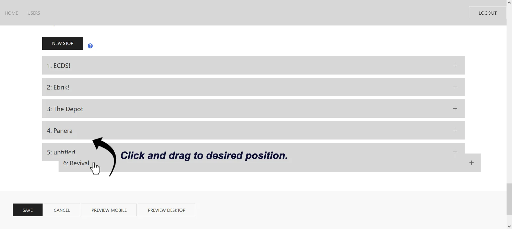

### 4. How to Add Tour Pages:

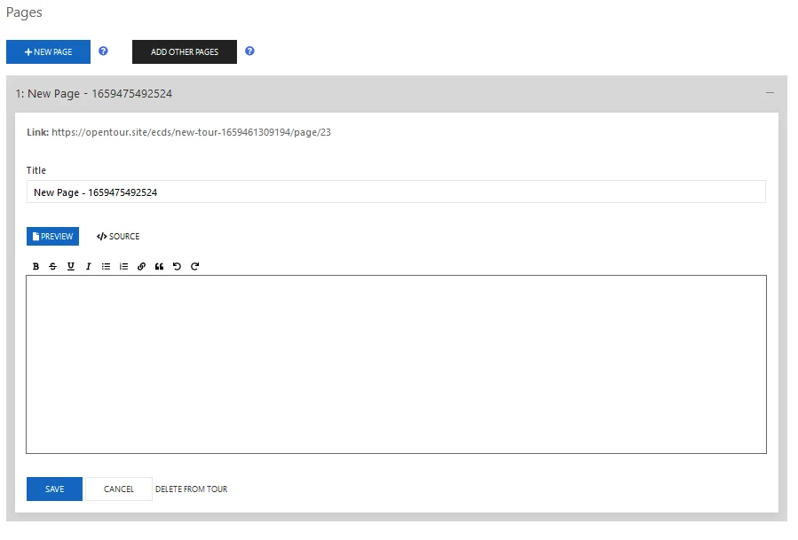

####  &nbsp;&nbsp;&nbsp;&nbsp;&nbsp;&nbsp;a.	What is a tour page? Where are they?
  &nbsp;&nbsp;&nbsp;&nbsp;&nbsp;&nbsp;&nbsp;&nbsp;&nbsp;&nbsp;&nbsp;&nbsp;i.	Tour pages appear in the header on desktop/laptop and in the home menu on the mobile view.  
  &nbsp;&nbsp;&nbsp;&nbsp;&nbsp;&nbsp;&nbsp;&nbsp;&nbsp;&nbsp;&nbsp;&nbsp;ii.	They provide additional information that you want to share about the project, that is not related to the map. This can include an “About” page, essays related to the tour subject, a page about the project team who created the tour, or other such non-georeferenced informational pages. 
####  &nbsp;&nbsp;&nbsp;&nbsp;&nbsp;&nbsp;b.	Click “New Page” 
  &nbsp;&nbsp;&nbsp;&nbsp;&nbsp;&nbsp;&nbsp;&nbsp;&nbsp;&nbsp;&nbsp;&nbsp;i.	to add an informational page with no associated map point. 
####  &nbsp;&nbsp;&nbsp;&nbsp;&nbsp;&nbsp;c.	Click on "ADD OTHER PAGES" to copy or duplicate a page from another tour in your Tour Site. 
  &nbsp;&nbsp;&nbsp;&nbsp;&nbsp;&nbsp;&nbsp;&nbsp;&nbsp;&nbsp;&nbsp;&nbsp;i.	You may want to have the same "About the Team" page on every tour, for instance. 
####  &nbsp;&nbsp;&nbsp;&nbsp;&nbsp;&nbsp;d.	Add a “Page Title” 
  &nbsp;&nbsp;&nbsp;&nbsp;&nbsp;&nbsp;&nbsp;&nbsp;&nbsp;&nbsp;&nbsp;&nbsp;i.	The Page Title will show up in the menu on your OpenTour (e.g. Find Out More). 

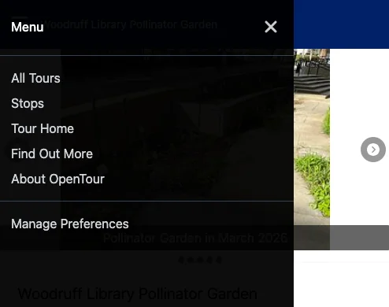

####  &nbsp;&nbsp;&nbsp;&nbsp;&nbsp;&nbsp;e.	Add any page content you want through the Page Content section. 
  &nbsp;&nbsp;&nbsp;&nbsp;&nbsp;&nbsp;&nbsp;&nbsp;&nbsp;&nbsp;&nbsp;&nbsp;i.	It contains the same basic text editor seen on the main tour page and the stops. 
  &nbsp;&nbsp;&nbsp;&nbsp;&nbsp;&nbsp;&nbsp;&nbsp;&nbsp;&nbsp;&nbsp;&nbsp;ii.	The “html” button `[</> SOURCE]` will allow for iframes or other unique content and styling. 
  &nbsp;&nbsp;&nbsp;&nbsp;&nbsp;&nbsp;&nbsp;&nbsp;&nbsp;&nbsp;&nbsp;&nbsp;iii.	The “Link” line will show the public link to this page, for reference. 
####  &nbsp;&nbsp;&nbsp;&nbsp;&nbsp;&nbsp;f.	Click SAVE 
  &nbsp;&nbsp;&nbsp;&nbsp;&nbsp;&nbsp;&nbsp;&nbsp;&nbsp;&nbsp;&nbsp;&nbsp;i.	Click Save at the bottom of the Page menu, and then the bottom of the overall tour page. 
####  &nbsp;&nbsp;&nbsp;&nbsp;&nbsp;&nbsp;g.	**NOTE** Text color / style.
  &nbsp;&nbsp;&nbsp;&nbsp;&nbsp;&nbsp;&nbsp;&nbsp;&nbsp;&nbsp;&nbsp;&nbsp;i.	Text on OpenTour Pages defaults to light text on a dark background for Desktop view and Mobile view. If you plan to alter your html/css for Page text, keep in mind that this may make it harder to read. See the default text color for Desktop view and Mobile view below.

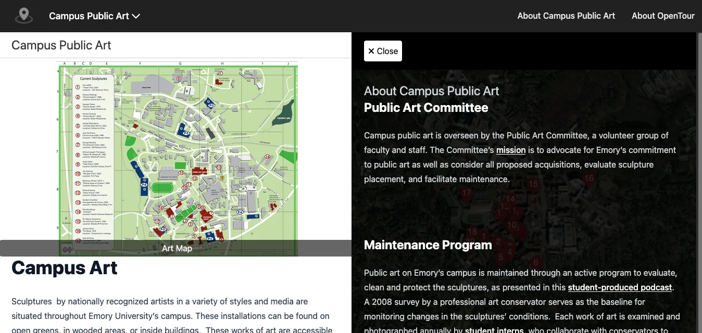
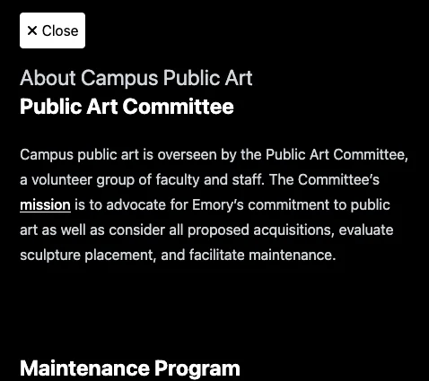

### 5. Additional "how-to" information:
####  &nbsp;&nbsp;&nbsp;&nbsp;&nbsp;&nbsp;a.	For any iframe in OpenTour:
  &nbsp;&nbsp;&nbsp;&nbsp;&nbsp;&nbsp;&nbsp;&nbsp;&nbsp;&nbsp;&nbsp;&nbsp;i.	If you want to include an iframe of an external feature on a stop or page related to your tour stop, you can do so in a page, the main tour page, or in an individual stop by using the html button `[</> SOURCE]` and pasting in the iframe code. 
  &nbsp;&nbsp;&nbsp;&nbsp;&nbsp;&nbsp;&nbsp;&nbsp;&nbsp;&nbsp;&nbsp;&nbsp;ii.	The iframe settings must be `<iframe src="<Url>"></iframe>` with any other specifications you need included. The `<Url>` is the url to your particular page being iframed. You can include `style="width:100%;height:300px;"` with any width/height ratio, or `width="100%"` and `height="300px"` with any width/height ratio. 

####  &nbsp;&nbsp;&nbsp;&nbsp;&nbsp;&nbsp;b.	For an OpenTour Timeline.js timeline:
  &nbsp;&nbsp;&nbsp;&nbsp;&nbsp;&nbsp;&nbsp;&nbsp;&nbsp;&nbsp;&nbsp;&nbsp;i.	If you want to include an interactive timeline of events related to your tour, you can do so in a page, the main tour page, or in an individual stop by using the html button `[</> SOURCE]` and iframing in a timeline.js tour. 
  &nbsp;&nbsp;&nbsp;&nbsp;&nbsp;&nbsp;&nbsp;&nbsp;&nbsp;&nbsp;&nbsp;&nbsp;ii.	The iframe settings must be “width=100%” and height=“350px” so that it will load and be visible on a mobile phone screen.  
  &nbsp;&nbsp;&nbsp;&nbsp;&nbsp;&nbsp;&nbsp;&nbsp;&nbsp;&nbsp;&nbsp;&nbsp;iii.	The “Headline” field needs to have circa 22 characters/letters or less (including spaces), more than that will break lines and make the timeline much less legible.   
  &nbsp;&nbsp;&nbsp;&nbsp;&nbsp;&nbsp;&nbsp;&nbsp;&nbsp;&nbsp;&nbsp;&nbsp;iv.	The “Text” field is easiest to read with one line of circa 40 characters/letters, but the user can scroll if you want to include more text. In that case you may want to add a warning to the “Stop” or “Page” description field in your OpenTour that the user will need to scroll in the timeline. 
  &nbsp;&nbsp;&nbsp;&nbsp;&nbsp;&nbsp;&nbsp;&nbsp;&nbsp;&nbsp;&nbsp;&nbsp;v.	The “Media” field in the timeline will show up BELOW the text entered, so will require scrolling by the user.  Therefore, using the “Background” field for an image will be cleaner and more legible. 
  &nbsp;&nbsp;&nbsp;&nbsp;&nbsp;&nbsp;&nbsp;&nbsp;&nbsp;&nbsp;&nbsp;&nbsp;vi.	Use the “html” button `[</> SOURCE]` in OpenTour to add your iframe to a page or stop.  Stops must be saved by the stop’s “Save” button.   

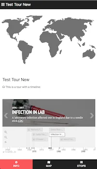 
Example timeline using ‘background’ field and short text. You can see more on how to create a simple timeline.js timeline at: https://timeline.knightlab.com/

####  &nbsp;&nbsp;&nbsp;&nbsp;&nbsp;&nbsp;c.	For a Matterport 3d view in OpenTour:
  &nbsp;&nbsp;&nbsp;&nbsp;&nbsp;&nbsp;&nbsp;&nbsp;&nbsp;&nbsp;&nbsp;&nbsp;i.	If you want to include an interactive 3d Matterport scan of a stop related to your tour stop, you can do so in a page, the main tour page, or in an individual stop by using the html button `[</> SOURCE]` and iframing in the Matterport tour link. 
  &nbsp;&nbsp;&nbsp;&nbsp;&nbsp;&nbsp;&nbsp;&nbsp;&nbsp;&nbsp;&nbsp;&nbsp;ii.	The iframe settings must be `<iframe src="<matterport Url>"></iframe>` where the `<matterport Url>` is the url to your particular 3d view.  

####  &nbsp;&nbsp;&nbsp;&nbsp;&nbsp;&nbsp;d.	For a Theta 360 view in OpenTour:
  &nbsp;&nbsp;&nbsp;&nbsp;&nbsp;&nbsp;&nbsp;&nbsp;&nbsp;&nbsp;&nbsp;&nbsp;i.	If you want to include an interactive 360 Theta scan of a stop related to your tour stop, you can do so in a page, the main tour page, or in an individual stop by using the html button `[</> SOURCE]` and iframing in the Theta embed link. 
  &nbsp;&nbsp;&nbsp;&nbsp;&nbsp;&nbsp;&nbsp;&nbsp;&nbsp;&nbsp;&nbsp;&nbsp;ii.	The iframe settings must be `<iframe src="<Theta embed Url>"></iframe>` where the `<Theta embed Url>` is the url to your particular 360 view.  
  &nbsp;&nbsp;&nbsp;&nbsp;&nbsp;&nbsp;&nbsp;&nbsp;&nbsp;&nbsp;&nbsp;&nbsp;ii.	To get the embed URL, click the icon with four arrows pointing out, on your Theta 360 post page, below your 360 image. This will bring up a pop-up. The URL of the pop-up is your Theta embed URL. 
  &nbsp;&nbsp;&nbsp;&nbsp;&nbsp;&nbsp;&nbsp;&nbsp;&nbsp;&nbsp;&nbsp;&nbsp;iv.	The iframe settings will need width and height. Something like “width=100%” and height=“350px” will make it so that it will load and be visible on a mobile phone screen.  

####  &nbsp;&nbsp;&nbsp;&nbsp;&nbsp;&nbsp;e.	For Soundcloud audio in OpenTour (3.0): 
  &nbsp;&nbsp;&nbsp;&nbsp;&nbsp;&nbsp;&nbsp;&nbsp;&nbsp;&nbsp;&nbsp;&nbsp;i.	** This information was for OpenTOUR 3.0 - SoundCloud audio can now be added to the standard Media slider. **Copy the embed code and paste in the Media bar. 
  &nbsp;&nbsp;&nbsp;&nbsp;&nbsp;&nbsp;&nbsp;&nbsp;&nbsp;&nbsp;&nbsp;&nbsp;ii.	If you want to include an audio clip related to your tour stop or tour, you can do so in a page, the main tour page, or in an individual stop by using the html button `[</> SOURCE]` and iframing in the particular clip from Soundcloud. 
  &nbsp;&nbsp;&nbsp;&nbsp;&nbsp;&nbsp;&nbsp;&nbsp;&nbsp;&nbsp;&nbsp;&nbsp;iii.	The iframe settings must be `<iframe src="<soundcloud Url>"></iframe>` where the `<soundcloud Url>` is the url to your particular audio clip.  

### 6. Using an OpenTour Tour:
####  &nbsp;&nbsp;&nbsp;&nbsp;&nbsp;&nbsp;a.	Using Turn-by-turn directions.
  &nbsp;&nbsp;&nbsp;&nbsp;&nbsp;&nbsp;&nbsp;&nbsp;&nbsp;&nbsp;&nbsp;&nbsp;i.	Maps on desktop are now (10/2026) provided by open-source MapLibre. On mobile, maps and map directions are provided using Google maps, and a user can get directions from their current location to the desired map stop.   
  &nbsp;&nbsp;&nbsp;&nbsp;&nbsp;&nbsp;&nbsp;&nbsp;&nbsp;&nbsp;&nbsp;&nbsp;ii.	To do this, make sure that the phone is set to allow location access for the mobile browser. 
  &nbsp;&nbsp;&nbsp;&nbsp;&nbsp;&nbsp;&nbsp;&nbsp;&nbsp;&nbsp;&nbsp;&nbsp;iii.	 Then go to the Menu of the tour on the top left.  Click "manage preferences" to open the Cookie Settings menu. Turn on the toggle next to "Google Maps" to allow the app location access. You can read through and make choices based on the other options. 
  &nbsp;&nbsp;&nbsp;&nbsp;&nbsp;&nbsp;&nbsp;&nbsp;&nbsp;&nbsp;&nbsp;&nbsp;iv.	 You will also get a pop-up with this information.

  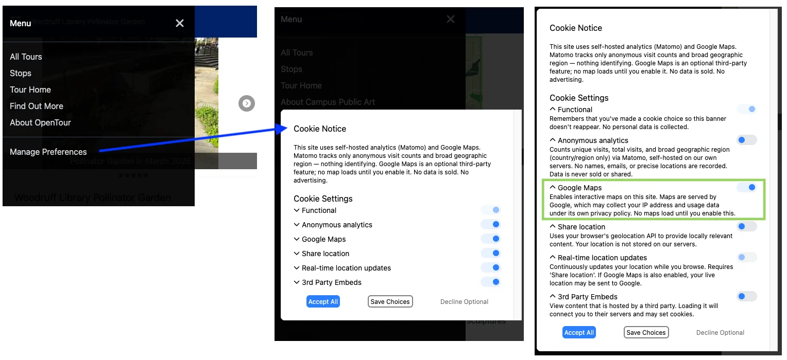 

####  &nbsp;&nbsp;&nbsp;&nbsp;&nbsp;&nbsp;b.	Using audio voice overs.
  &nbsp;&nbsp;&nbsp;&nbsp;&nbsp;&nbsp;&nbsp;&nbsp;&nbsp;&nbsp;&nbsp;&nbsp;i.	When accessing a tour on a mobile device, a user can click on an audio icon, in the shape of a headset, located at the top left corner of a text block. This will start an audio readout of the text by a computer voice. 

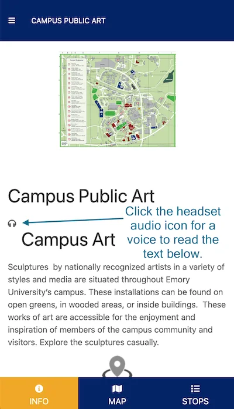 

####  &nbsp;&nbsp;&nbsp;&nbsp;&nbsp;&nbsp;c.	Tour time estimates:
  &nbsp;&nbsp;&nbsp;&nbsp;&nbsp;&nbsp;&nbsp;&nbsp;&nbsp;&nbsp;&nbsp;&nbsp;i.	When looking at tours on a Tour Site, published tours will provide an estimate of the time it takes to walk to all of the stops (or drive for driving tours). They will also provide an estimate how long it will take to read the text of the tour.  
  &nbsp;&nbsp;&nbsp;&nbsp;&nbsp;&nbsp;&nbsp;&nbsp;&nbsp;&nbsp;&nbsp;&nbsp;ii.   **NOTE** These times are provided as estimates to assist users, and cannot be confirmed as accurate. 

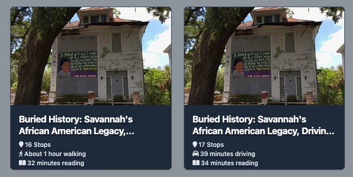 

####  &nbsp;&nbsp;&nbsp;&nbsp;&nbsp;&nbsp;3.	**Updated in 4.0** Using the Tour site:
  &nbsp;&nbsp;&nbsp;&nbsp;&nbsp;&nbsp;&nbsp;&nbsp;&nbsp;&nbsp;&nbsp;&nbsp;i.	On the Tour Site, a list of published tours will appear as tiles. Click on any tour to go to that tour's page.  At the top of the Tour Site, you will see "List" and "Map". List will show you the list of tours by name, tiled, as it is by default. If you switch to "Map", you will see the locations of the tours on a map, so that you can choose a tour by its general location. 

### 7. Troubleshooting:
####  &nbsp;&nbsp;&nbsp;&nbsp;&nbsp;&nbsp;a.	I cannot get logged in! What is going on?
  &nbsp;&nbsp;&nbsp;&nbsp;&nbsp;&nbsp;&nbsp;&nbsp;&nbsp;&nbsp;&nbsp;&nbsp;i.	If you see the admin, admin header, but no tour sites, as below, you DO have an OpenTour account, but do NOT have access to any Tour Sites. If this is your **first** login, contact an admin to get access to a Tour Site. If this is not your first time, you have most likely logged in with a different email address than you used to set up your account. You will see the message "*If you have had access to tour sites in the past, and should still have access, please check to make sure that you used the same GMail, Facebook, Twitter or GitHub account that you have previously used. If you use another account, your tour sites will not show!*" Logging in with a new or different email address will create a new (empty) OpenTour account, and you will not see your tours. Try logging out and back in with any other email addresses you might have used.

  &nbsp;&nbsp;&nbsp;&nbsp;&nbsp;&nbsp;&nbsp;&nbsp;&nbsp;&nbsp;&nbsp;&nbsp;ii.	If you log in, but you only see the admin header, no message ("*If you have....*" as above), one of two things has probably happened. 1) Make sure that you actually fully logged into the site. Refresh the page, and the login options should reappear. Try your preferred login again. If you close out the gmail pop-up, you will see a blank admin with the admin header and no message, but you will not be logged into the site. If you are logged into the site, when you refresh the login options will *Not* reappear. 2) Make sure you are logging into the correct URL. Admin URLs are NOT the same as your Tour Site URL + /admin. You need to log into https://opentour.site/admin/my-tour-site-name/. If you try to log into the public-facing Tour Site URL + /admin, it will not log you into the site. 
   &nbsp;&nbsp;&nbsp;&nbsp;&nbsp;&nbsp;&nbsp;&nbsp;&nbsp;&nbsp;&nbsp;&nbsp;iii.	If you have any other error, please contact us!
####  &nbsp;&nbsp;&nbsp;&nbsp;&nbsp;&nbsp;b.	My iframed content is displaying oddly. What do I do?
  &nbsp;&nbsp;&nbsp;&nbsp;&nbsp;&nbsp;&nbsp;&nbsp;&nbsp;&nbsp;&nbsp;&nbsp;i.	Try including the width and height information for a clear display on desktop and mobile. We recommend “width=100%” and height=“350px” so that it will load and be visible on a mobile phone screen.    
&nbsp;&nbsp;&nbsp;&nbsp;&nbsp;&nbsp;&nbsp;&nbsp;&nbsp;&nbsp;&nbsp;&nbsp;ii.	Check out more information [on Iframes](#a-for-any-iframe-in-opentour "Iframe Information"). 
####  &nbsp;&nbsp;&nbsp;&nbsp;&nbsp;&nbsp;c.	Why are the filenames showing up under my images and titles I didn't create on videos in the media slider?
  &nbsp;&nbsp;&nbsp;&nbsp;&nbsp;&nbsp;&nbsp;&nbsp;&nbsp;&nbsp;&nbsp;&nbsp;i.	The "Image Title" field imports the image filename or the title of a video from Vimeo or Youtube. OpenTour Builder is designed to ignore image filenames, but it will display the imported title of a video.  In some cases you may see an image filename display due to the editing process. In order to fix this, you need to edit the "Image Title" field for that media item.

  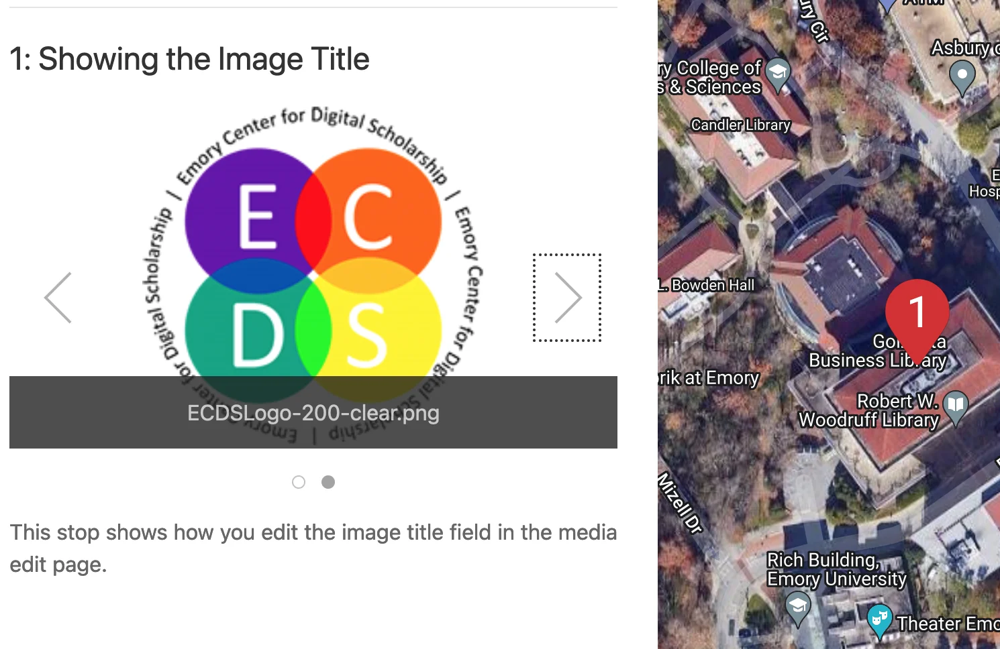 

  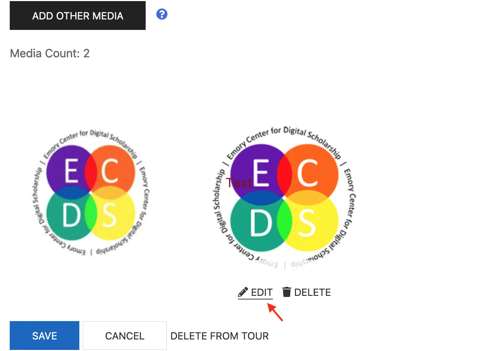 

  &nbsp;&nbsp;&nbsp;&nbsp;&nbsp;&nbsp;&nbsp;&nbsp;&nbsp;&nbsp;&nbsp;&nbsp;ii.	Go to the media item (image, video clip, or SoundCloud audio clip) in the media slider in the admin.  Click "EDIT" under the image.  This will open the edit menu for that media item.

  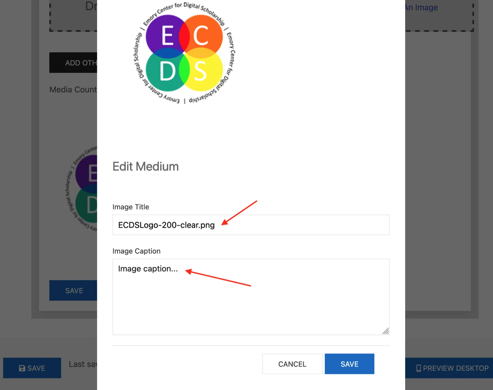 

  &nbsp;&nbsp;&nbsp;&nbsp;&nbsp;&nbsp;&nbsp;&nbsp;&nbsp;&nbsp;&nbsp;&nbsp;iii.	In that menu, delete the filename or title from the "Image Title" field. If you leave this field blank, the image or video will display with NO gray bar and NO title.  You can input any title that you want, and it will display in the gray bar on the mobile and desktop tour. 
  &nbsp;&nbsp;&nbsp;&nbsp;&nbsp;&nbsp;&nbsp;&nbsp;&nbsp;&nbsp;&nbsp;&nbsp;iv.  Edit the "Image Caption" field to add more information on the image or video that you want to ONLY display if a user clicks on that image or video for more information.  This field will not display by default, and can include a description, as well as copyright or licensing information.
####  &nbsp;&nbsp;&nbsp;&nbsp;&nbsp;&nbsp;d.	When I click on my tour from a tour site it goes to the wrong tour. OR When I click on a stop, my tour goes to the wrong stop. What is going on?
  &nbsp;&nbsp;&nbsp;&nbsp;&nbsp;&nbsp;&nbsp;&nbsp;&nbsp;&nbsp;&nbsp;&nbsp;i.	Remember, you cannot have two tours with the same name in your Tour Site, and you cannot have two stops with the same name in one Tour.  This will cause errors in the URLs, and you will also go to the first of the two (tours or stops). If you are running into this problem, just change the name of one, and it should solve the problem. 
####  &nbsp;&nbsp;&nbsp;&nbsp;&nbsp;&nbsp;e.	When I am working on a tour with other members of my group, not all the data I enter saves. Why isn't it saving?
  &nbsp;&nbsp;&nbsp;&nbsp;&nbsp;&nbsp;&nbsp;&nbsp;&nbsp;&nbsp;&nbsp;&nbsp;i.	OpenTour will save your work automatically as you work. It is also best practice to click 'save' on the Tour Stop and 'save' on the overall Tour at the end of every work session. While OpenTour is saving your work, is not automatically updating any edits entered by anyone else. Because of this, **only one person should enter data at a time**. If two people enter data (on separate browsers) at once, whichever edits are saved last will show, but the other edits will be overwritten, and not save. If you are working alongside others, you will need to *refresh your page before making changes* to prevent overwriting their work.
